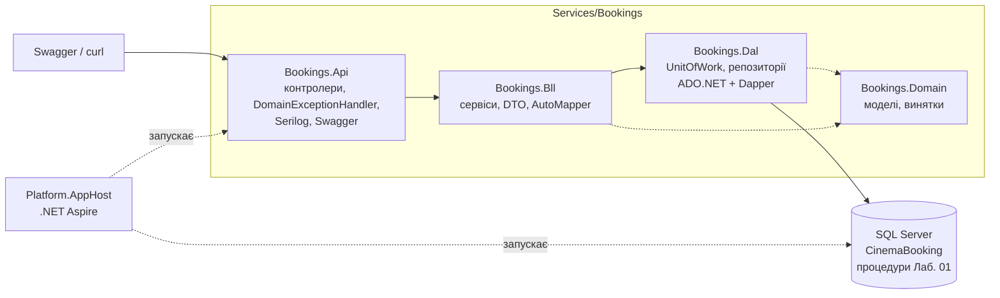

# Кінотеатр: мікросервісна платформа на .NET

Курс «Технології .NET». Один репозиторій на всі 10 лабораторних.

* **Лаб. 01:** проєктування баз даних для мікросервісної архітектури (`docs/`, `db/`)
* **Лаб. 02:** мікросервіс бронювань `Services/Bookings`: тришарова архітектура (Api → Bll → Dal) на ADO.NET та Dapper, запуск через .NET Aspire (`Platform.AppHost`)

## Швидкий старт: уся платформа однією командою (.NET Aspire)

**Що потрібно:** .NET 10 SDK, Docker Desktop (запущений), IDE (Rider / Visual Studio / VS Code) або термінал.

```bash
git clone https://github.com/aanastasiaakk/cinema-microservices.git
cd cinema-microservices
dotnet run --project Platform.AppHost
```

У Rider: оберіть конфігурацію запуску **Platform.AppHost** → Run.

Aspire піднімає контейнер **SQL Server** (ресурс `sql`, база `CinemaBooking`) і **Bookings API** (ресурс `bookings-api`). API стартує лише після того, як база готова (`WaitFor`), і при першому запуску застосовує до порожньої бази скрипти Лаб. 01 `db/p1/schema.sql → procedures.sql → seed.sql` (вони ідемпотентні). Посилання на **Aspire Dashboard** друкується в консолі. У Dashboard обидва ресурси мають бути в статусі **Running**; клікніть адресу `bookings-api`, щоб відкрити **Swagger** (`/swagger`).

Детально про сервіс, схему рішення й приклади запитів див. [розділ 11](#11-лаб-02-мікросервіс-бронювань-servicesbookings).

## 1. Предметна область

Онлайн-система мережевого кінотеатру. **Глядачі** переглядають афішу й розклад, бронюють і оплачують квитки на конкретні місця, а після перегляду залишають відгуки та обговорюють фільми. **Адміністратори** ведуть каталог фільмів, залів і сеансів, **касири** перевіряють бронювання на вході в зал.

## 2. Три незалежні контексти (Bounded Contexts)

Кожен контекст це окремий мікросервіс з **власною БД**. Між базами немає спільних таблиць і **жодного FOREIGN KEY**: сутність іншого контексту відома лише за її Id (звичайний стовпець або поле).

| № | Контекст | БД | Технологія | Сутності (належать лише цьому контексту) |
|---|---|---|---|---|
| 1 | **Booking**: бронювання й оплата | `CinemaBooking` | SQL Server + ADO.NET & Dapper (Лаб. 02) | Customer, Booking, BookingDetail, Ticket, Payment (+ локальна копія Showtime) |
| 2 | **Catalog**: фільми, зали, розклад | `CinemaCatalog` | SQL Server + EF Core Code First (Лаб. 03) | Movie, MovieDetail, Genre, MovieGenre, Hall, Showtime |
| 3 | **Reviews**: відгуки й обговорення | `cinema_reviews` | MongoDB (Лаб. 04) | reviews (з вбудованими comments), discussions, discussionMessages, movieRatings |

Детально про контексти, агрегати й власників даних: [docs/contexts.md](docs/contexts.md).

## 3. Таблиця політики дублювання даних

Кожне поле, що дублюється між базами, має **одного власника**. Копія або є **знімком** (свідомо не оновлюється), або **оновлюється подіями** від власника (eventual consistency, механізм у Лаб. 08). Подвійного запису немає. FK на іншу базу немає ні для одного поля.

| Поле (копія) | Де зберігається | Джерело (власник даних) | Політика узгодженості |
|---|---|---|---|
| `Tickets.MovieTitle`, `Tickets.UnitPrice`, `Tickets.StartsAt` | CinemaBooking (P1) | `Movies.Title`, `Showtimes.Price`, `Showtimes.StartsAt` (CinemaCatalog) | **знімок** на момент бронювання, не оновлюється (квиток фіксує те, що купив глядач) |
| `Showtimes.MovieTitle`, `HallName`, `StartsAt`, `BasePrice`, `Capacity` (локальна копія сеансу, `Id` = Id з Каталогу) | CinemaBooking (P1) | `Showtimes` + `Movies` + `Halls` (CinemaCatalog) | **оновлюється подіями** `ShowtimeScheduled` / `ShowtimeChanged` з Каталогу; Booking ці поля не редагує |
| `reviews.movieTitle`, `discussions.movieTitle`, `movieRatings.movieTitle` | cinema_reviews (P3) | `Movies.Title` (CinemaCatalog) | **оновлюється подіями** `MovieRenamed` (`updateMany` за `movieId`) |
| `reviews.author.displayName`, `discussions.createdBy.displayName`, `discussionMessages.author.displayName` | cinema_reviews (P3) | `Customers.FullName` (CinemaBooking) | **оновлюється подіями** `CustomerRenamed` |
| `reviews.verifiedViewer` | cinema_reviews (P3) | бронювання зі статусом `CheckedIn` (CinemaBooking) | **знімок** на момент написання відгуку, не оновлюється |
| `Movies.AverageRating`, `Movies.ReviewsCount` | CinemaCatalog (P2) | `movieRatings` (cinema_reviews) | **оновлюється подіями** `MovieRatingChanged` після перерахунку рейтингу |
| `discussions.recentMessages[]` (3 останні) | cinema_reviews (P3), всередині однієї БД | `discussionMessages` | оновлюється в тій самій операції, що додає повідомлення (`$push` + `$slice: -3`) |

Пари сервісів, що взаємодіють: Catalog → Booking, Catalog → Reviews, Booking → Reviews, Reviews → Catalog. Для кожної пари в таблиці є щонайменше один рядок.

## 4. Структура репозиторію

```
README.md                  опис домену, контексти, дублювання, розгортання, запуск
Platform.slnx              одне рішення на всю платформу
Platform.AppHost/          оркестрація .NET Aspire (AppHost.cs)
Services/
  Bookings/                Проєкт №1: мікросервіс бронювань (ADO.NET + Dapper)
    Bookings.Api/          контролери, middleware, Program.cs, appsettings.json
    Bookings.Bll/          сервіси, DTO, профілі AutoMapper
    Bookings.Dal/          інтерфейси репозиторіїв, ADO.NET/Dapper-реалізації, Unit of Work
    Bookings.Domain/       моделі, доменні винятки
    Bookings.Tests/        unit, integration і API-тести
docs/
  contexts.md              межі контекстів, агрегати, власники даних
  erd.md                   ERD Проєктів №1 і №2 (+ erd-p1.png, erd-p2.png, cross-db-links.png)
  erd-p1.dbml, erd-p2.dbml ті самі ERD для імпорту в dbdiagram.io
  mongodb-documents.md     колекції, приклади документів, індекси, агрегації
db/
  docker-compose.yml       SQL Server 2022 + MongoDB 7 локально
  p1/  schema.sql · procedures.sql · seed.sql · checks.sql   (CinemaBooking)
  p2/  schema.sql · seed.sql                                 (CinemaCatalog)
  p3/  collections.js · seed.js · queries.js                 (cinema_reviews)
```

## 5. Розгортання з нуля

Потрібні **Docker** (або встановлені локально SQL Server 2019+ і MongoDB 6+) і термінал. Усі скрипти **ідемпотентні**: їх можна запускати повторно, вони не падають і не створюють дублікатів.

### 5.1. Запустити СУБД

```bash
# з кореня репозиторію
docker compose -f db/docker-compose.yml up -d
# зачекати ~20 секунд, поки SQL Server стартує
```

Пароль `sa` береться зі змінної `MSSQL_SA_PASSWORD` (за замовчуванням `Your_strong_Passw0rd`). Далі в командах використовується змінна `SA`:

```bash
SA='Your_strong_Passw0rd'
SQL="docker exec -i cinema-mssql /opt/mssql-tools18/bin/sqlcmd -C -S localhost -U sa -P $SA -b -f 65001"
```

> Без Docker ті самі файли можна виконати в SSMS / Azure Data Studio / `sqlcmd -i <файл>` у вказаному порядку.

### 5.2. Проєкт №1: CinemaBooking

```bash
$SQL -i /db/p1/schema.sql       # 1) створює БД CinemaBooking, таблиці, ключі, обмеження, індекси, view
$SQL -i /db/p1/procedures.sql   # 2) 6 збережуваних процедур
$SQL -i /db/p1/seed.sql         # 3) тестові дані (повторний запуск не дублює)
$SQL -i /db/p1/checks.sql       # 4) перевірка: FK, індекси, CRUD, транзакції, недопустимі переходи
```

### 5.3. Проєкт №2: CinemaCatalog

```bash
$SQL -i /db/p2/schema.sql       # 1) створює БД CinemaCatalog, 6 таблиць, ключі, індекси, view
$SQL -i /db/p2/seed.sql         # 2) довідникові дані: жанри, фільми, зали, сеанси
```

### 5.4. Проєкт №3: cinema_reviews (MongoDB)

```bash
docker exec cinema-mongo mongosh --quiet /db/p3/collections.js   # 1) колекції, $jsonSchema, індекси
docker exec cinema-mongo mongosh --quiet /db/p3/seed.js          # 2) документи (upsert за _id)
docker exec cinema-mongo mongosh --quiet /db/p3/queries.js       # 3) приклади запитів і агрегацій
```

### 5.5. Таблиця політики дублювання

Після розгортання див. розділ 3 цього README: кожне дубльоване поле, його власник і політика.

## 6. Проєкт №1: що всередині

**Таблиці (6):** `Customers`, `Bookings`, `BookingDetails`, `Tickets`, `Payments`, `Showtimes` (локальна копія).

| Зв'язок | Реалізація |
|---|---|
| 1:1 | `Bookings` ↔ `BookingDetails`: `BookingDetails.BookingId` одночасно PK і FK (`ON DELETE CASCADE`) |
| 1:N | `Customers` → `Bookings` (`NO ACTION`: клієнта з історією не видаляємо), `Bookings` → `Payments` |
| M:N | `Bookings` ↔ `Showtimes` через `Tickets` (два FK + місце, тип, знімок назви й ціни) |

**Обмеження:** PK на кожній таблиці; FK усередині БД; `UNIQUE` (`Email`, `BookingCode`, `ProviderTxnId`); `CHECK` (статуси, ціни > 0, формат email, місця > 0, канали, методи оплати); `DEFAULT` (статус `Created`, дати `SYSUTCDATETIME()`, `IsDeleted = 0`).

**Каскади усвідомлено:** `CASCADE` лише для частин агрегату (`BookingDetails`, `Tickets`), `NO ACTION` для клієнта, оплат і сеансів (історія та фінансові дані не мають зникати).

**Первинні ключі:** `BIGINT IDENTITY`, бо записи створює лише сервіс Booking (одне джерело, послідовна вставка, компактний кластерний індекс). `Showtimes.Id` без IDENTITY, бо це Id, згенерований Каталогом.

**Індекси (кожен під запит):**

| Індекс | Запит |
|---|---|
| `IX_Bookings_Customer_Status_Active` (фільтр `IsDeleted = 0`, INCLUDE) | «мої бронювання» клієнта за статусом, новіші першими, з пагінацією |
| `IX_Bookings_AwaitingPayment_BookedAt` (фільтр `Status = 'AwaitingPayment'`) | фонова задача: скасувати неоплачені бронювання старші за 15 хв |
| `IX_Tickets_Showtime_Seat` | схема залу (зайняті місця) і перевірка «місце вільне» в `usp_Booking_AddTicket` |
| `IX_Payments_Booking_Status` | історія оплат бронювання, перевірка оплати при переході в `Paid` |
| `IX_Showtimes_StartsAt` | розклад сеансів на дату для каси |
| `UX_Payments_ProviderTxnId` (unique, фільтр `IS NOT NULL`) | callback платіжної системи за Id транзакції + захист від повторного запису |

**Аудит, м'яке видалення, конкурентність:** `CreatedAt`, `CreatedBy`, `UpdatedAt`, `UpdatedBy`, `IsDeleted` у `Customers` і `Bookings`. `ROWVERSION` там, де можливий паралельний запис: `Customers` (профіль редагують клієнт і адміністратор), `Bookings` (статус одночасно змінюють каса, платіжний сервіс і клієнт), `Payments` (статус оплати змінюють callback провайдера і повернення коштів). `Payments` має аудит, але не має `IsDeleted`: фінансові записи не видаляються. `BookingDetails` змінюється лише разом з бронюванням (його аудит і `RowVersion` у `Bookings`), `Tickets` це незмінний знімок (лише `CreatedAt`). Процедури приймають очікуваний `RowVersion` і відмовляють помилкою `50011`, якщо запис уже змінив хтось інший, тому зміни не затираються «тихо».

**Збережувані процедури (6):**

| Процедура | Тип | Що робить |
|---|---|---|
| `usp_Customer_Upsert` | CRUD | створює або оновлює клієнта (оновлення з перевіркою `RowVersion`) |
| `usp_Booking_GetById` | CRUD (read) | бронювання + деталі, квитки, оплати (3 набори результатів) |
| `usp_Booking_SoftDelete` | CRUD (delete) | м'яке видалення, лише для скасованих |
| `usp_Booking_Create` | бізнес, транзакція | `Bookings` + `BookingDetails` атомарно |
| `usp_Booking_AddTicket` | бізнес, транзакція | перевіряє, що місце вільне (`UPDLOCK, HOLDLOCK`), робить знімок назви й ціни, перераховує суму |
| `usp_Booking_ChangeStatus` | бізнес, транзакція | **зміна статусу з перевіркою переходу** |

Допустимі переходи статусу (`usp_Booking_ChangeStatus`, явна транзакція, `SET XACT_ABORT ON`, `UPDLOCK` на рядок):

```
Created ──► AwaitingPayment ──► Paid ──► CheckedIn
   │               │
   └──► Cancelled ◄┘          (скасування лише ДО оплати)
```

Недопустимий перехід (наприклад, `AwaitingPayment → CheckedIn`, тобто пропустити в зал неоплачене бронювання, або `Paid → Cancelled`) завершується **керованою помилкою** `THROW 50002 'Invalid status transition: ...'`, транзакція відкочується, статус не змінюється. Додаткові бізнес-перевірки: `50040` (немає квитків), `50041` (не оплачено повністю), `50042` (check-in раніше ніж за годину до сеансу).

## 7. Проєкт №2: що всередині

**Сутності (6):** `Genre`, `Movie`, `MovieDetail`, `MovieGenre`, `Hall`, `Showtime`.

| Зв'язок | Реалізація |
|---|---|
| 1:1 | `Movies` ↔ `MovieDetails` (`MovieId` є PK і FK) |
| 1:N | `Movies` → `Showtimes`, `Halls` → `Showtimes` |
| M:N | `Movies` ↔ `Genres` через `MovieGenres` з **власними полями** `AddedAt` (дата додавання фільму в жанр) і `IsPrimary` |

Унікальні поля: `Genres.Name`, `Genres.Slug`, `Movies(Title, ReleaseYear)`, `Halls.Name`, `Showtimes(HallId, StartsAt)` (у залі не може бути двох сеансів одночасно), один основний жанр на фільм (фільтрований unique). CHECK: ціни > 0, рік, тривалість, віковий рейтинг, формат залу, мова. Індекси під запити: афіша за рейтингом, розклад фільму, фільми жанру.

**Готовність до міграцій:** іменування PK/FK/IX у конвенціях EF Core. У Лаб. 03 модель описується Fluent API, seed-дані задаються через `HasData`, а схема створюється й надалі змінюється міграціями (`dotnet ef migrations add InitialCatalog`, `dotnet ef database update`). `db/p2/schema.sql` це спроєктована цільова схема для перевірки.

## 8. Проєкт №3: що всередині

4 колекції: `reviews`, `discussions`, `discussionMessages`, `movieRatings`.

* **Embedding:** `reviews.author`, `reviews.comments[]`, `reviews.criticInfo`
* **Referencing:** `reviews.discussionId` → `discussions`, `discussionMessages.discussionId` → `discussions`
* **Гібрид:** `discussions.recentMessages[]` (3 останні вбудовані) + повна історія в `discussionMessages`
* **Гнучка схема:** у `reviews` документи типу `viewer`, `quick`, `critic` мають різні набори полів
* **Денормалізація:** `movieTitle`, `author.displayName` (див. таблицю дублювання), read-модель `movieRatings`
* `$jsonSchema`-валідація, індекси під запити, aggregation pipeline: [docs/mongodb-documents.md](docs/mongodb-documents.md), `db/p3/queries.js`

## 9. ERD

### Проєкт №1 · CinemaBooking


### Проєкт №2 · CinemaCatalog


### Логічні посилання між базами (без FOREIGN KEY)


Код діаграм (Mermaid) і пояснення зв'язків:

* Проєкт №1: [docs/erd.md](docs/erd.md#проєкт-1--cinemabooking-sql-server-adonet--dapper), зображення `docs/erd-p1.png`
* Проєкт №2: [docs/erd.md](docs/erd.md#проєкт-2--cinemacatalog-sql-server-ef-core), зображення `docs/erd-p2.png`
* DBML для dbdiagram.io: `docs/erd-p1.dbml`, `docs/erd-p2.dbml`

## 10. Самоперевірка перед здачею

```bash
# 1) FK лише всередині своєї БД (жодного посилання на іншу базу)
$SQL -Q "USE CinemaBooking; SELECT name, OBJECT_NAME(referenced_object_id) FROM sys.foreign_keys"
$SQL -Q "USE CinemaCatalog; SELECT name, OBJECT_NAME(referenced_object_id) FROM sys.foreign_keys"

# 2) недопустимий перехід статусу -> керована помилка 50002, статус не змінюється
$SQL -I -Q "USE CinemaBooking; DECLARE @id BIGINT = (SELECT Id FROM Bookings WHERE BookingCode='SEED0002');
            EXEC usp_Booking_ChangeStatus @BookingId=@id, @NewStatus=N'CheckedIn'"

# 3) у MongoDB документи з різними наборами полів
docker exec cinema-mongo mongosh --quiet --eval 'db.getSiblingDB("cinema_reviews").reviews.find().toArray()'

# 4) повторний seed не створює дублікатів (кількість рядків не змінюється)
$SQL -i /db/p1/seed.sql && $SQL -i /db/p2/seed.sql
docker exec cinema-mongo mongosh --quiet /db/p3/seed.js
```

## 11. Лаб. 02: мікросервіс бронювань (Services/Bookings)

Вертикальний зріз «від БД до API» для Проєкту №1 (`CinemaBooking`): **DAL → BLL → Web/API**.

### 11.1. Схема рішення



Залежності спрямовані в один бік: **Api → Bll → Dal**, а **Domain** підключають і Dal, і Bll. Контролер ніколи не звертається до репозиторію напряму, лише через сервіс. SQL є тільки в `Bookings.Dal`.

| Проєкт | Що всередині |
|---|---|
| `Bookings.Domain` | моделі `Customer`, `Booking`, `BookingDetails`, `Ticket`, `Showtime`, `Payment`; константи статусів; `NotFoundException`, `BusinessConflictException`, `ValidationException` |
| `Bookings.Dal` | `IGenericRepository<T>`; `ICustomerRepository`, `IBookingRepository`, `IShowtimeRepository`, `IPaymentRepository`; `RepositoryBase`; `BaseDapperRepository<T>`; `UnitOfWork`; `SqlErrorMapper`; `DatabaseInitializer` |
| `Bookings.Bll` | `CustomerService`, `BookingService`, `PaymentService`, `ShowtimeService`; DTO (`Dto/`); профілі AutoMapper (`Mapping/`) |
| `Bookings.Api` | `CustomersController`, `BookingsController`, `ShowtimesController`; `DomainExceptionHandler` (ProblemDetails); `CorrelationIdMiddleware`; `Program.cs` (DI, Serilog, Swagger) |
| `Bookings.Tests` | unit-тести BLL (Moq), перевірка AutoMapper, integration-тести UoW (відкат), API-тести (`WebApplicationFactory`) |

### 11.2. DAL: репозиторії і Unit of Work

| Репозиторій | Технологія | Що показує |
|---|---|---|
| `CustomerRepository` | **чистий ADO.NET** (`SqlCommand`, `SqlParameter` з типами, `SqlDataReader`) | ручне читання й мапінг, `OUTPUT INSERTED.Id`, оновлення з перевіркою `RowVersion`; **свідомо не успадковує** Generic Repository |
| `BookingRepository` | ADO.NET + **Dapper**, `BaseDapperRepository<Booking>` | multi-mapping (бронювання + деталі + квитки одним запитом), виклик процедур `usp_Booking_ChangeStatus` і `usp_Booking_SoftDelete`, блокування місця `UPDLOCK, HOLDLOCK` |
| `ShowtimeRepository` | ADO.NET + Dapper, `BaseDapperRepository<Showtime>` | розклад, зайняті місця (мапінг у кортежі) |
| `PaymentRepository` | ADO.NET + Dapper, `BaseDapperRepository<Payment>` | пошук за idempotency-ключем |

* **Generic Repository:** спільний CRUD (`GetByIdAsync`, `GetPageAsync`, `AddAsync`, `UpdateAsync`, `DeleteAsync`) написаний один раз у `BaseDapperRepository<T>`. Конкретні інтерфейси успадковують `IGenericRepository<T>` і додають лише специфічні запити.
* **Параметризація:** усі значення передаються тільки параметрами (`@Id`, `@Name`, ...). Ім'я таблиці в `BaseDapperRepository<T>` це константа з коду, а не вхідні дані. Перевірено: ім'я `O'Brien` і навіть `O'Brien; DROP TABLE x--` зберігаються як звичайний текст.
* **Звільнення ресурсів:** команди й reader-и в `await using`; з'єднання одне на запит, закривається в `UnitOfWork.DisposeAsync()` і повертається в пул SqlClient.
* **Unit of Work** (`Scoped`): одне `SqlConnection` на HTTP-запит, `BeginTransactionAsync(IsolationLevel)`, `CommitAsync`, `RollbackAsync`, `DisposeAsync`. Усі репозиторії отримують **спільне з'єднання і поточну транзакцію** через `Func<SqlTransaction?>`.
* **Рівень ізоляції і таймаути:** `ReadCommitted` (за замовчуванням SQL Server) плюс точкові блокування там, де потрібна гарантія (`UPDLOCK, HOLDLOCK` при перевірці місця, `UPDLOCK` у процедурі зміни статусу). Компроміс такий: `RepeatableRead`/`Serializable` прибирають більше аномалій читання, але довше тримають більше блокувань, і ризик взаємних блокувань (deadlock) різко зростає. Таймаут з'єднання 15 с (`Connect Timeout`), таймаут команд 30 с (`RepositoryBase.CommandTimeoutSeconds`).
* **Помилки БД → доменні винятки** (`SqlErrorMapper`): `THROW 50001/50012/50031` → `NotFoundException`; `50002` (недопустимий перехід) та інші бізнес-помилки процедур, а також `2601/2627` (UNIQUE) і `547` → `BusinessConflictException`. Сирі SQL-повідомлення в API не потрапляють.

### 11.3. BLL: транзакційні бізнес-операції

| Операція | Репозиторії в одній транзакції | Таблиці | Відкат, якщо... |
|---|---|---|---|
| `BookingService.CreateAsync` | Customers, Bookings, Showtimes | Bookings, BookingDetails, Tickets | будь-яке місце вже зайняте (409), сеанс не існує (404) або вже почався (409) |
| `PaymentService.PayAsync` | Payments, Bookings (процедура) | Payments, Bookings | процедура `usp_Booking_ChangeStatus` відмовляє (наприклад, бронювання ще не передане на оплату → `Created -> Paid`, 409): запис оплати відкочується |

* **Знімок за політикою дублювання Лаб. 01:** при створенні квитка назва фільму, час і ціна беруться з `Showtimes` і записуються в `Tickets` (студентський квиток коштує 80% ціни, дитячий 60%).
* **Idempotency:** `POST /api/bookings/{id}/payments` вимагає заголовок `Idempotency-Key`. Повтор з тим самим ключем повертає ту саму оплату (200) і **не списує гроші вдруге**. Ключ зберігається в `Payments.ProviderTxnId` (UNIQUE).
* **Конкурентність:** pessimistic для продажу місць (блокування рядків, бо конкуренція за популярні місця часта); optimistic (`RowVersion`) для профілю клієнта й переходу в `Paid`, бо там конфлікти рідкісні.
* **Валідація на двох рівнях:** DataAnnotations на DTO (`[Required]`, `[EmailAddress]`, `[Range]`, `[RegularExpression]`) відхиляють запит ще до сервісу (400). Бізнес-правила зі станом БД перевіряє сервіс: клієнт існує, email унікальний, місце вільне, сума оплати дорівнює сумі бронювання.
* **AutoMapper:** профілі `CustomerProfile`, `BookingProfile`, `PaymentProfile` у `Bookings.Bll/Mapping`, реєструються одним `AddAutoMapper(...)` у `Program.cs`. Конфігурацію перевіряє тест `AssertConfigurationIsValid`. Ключ Community-ліцензії (automapper.io) задається в `AutoMapper:LicenseKey`; без нього застосунок працює, лише пише попередження в лог.

### 11.4. API: ендпоінти і статуси

| Метод | Шлях | Успіх | Помилки |
|---|---|---|---|
| GET | `/api/showtimes?days=90` | 200 | 400 |
| GET | `/api/showtimes/{id}` · `/api/showtimes/{id}/seats` | 200 | 404 |
| GET | `/api/customers?name=&page=&pageSize=` | 200 | 400 |
| GET | `/api/customers/{id}` | 200 | 404 |
| POST | `/api/customers` | **201** + Location | 400, 409 (email зайнятий) |
| PUT | `/api/customers/{id}` | 200 | 400, 404, 409 (застарілий RowVersion) |
| DELETE | `/api/customers/{id}` | **204** | 404, 409 (є активні бронювання) |
| GET | `/api/customers/{id}/bookings?status=` | 200 | 400, 404 |
| GET | `/api/bookings/{id}` | 200 | 404 |
| POST | `/api/bookings` | **201** + Location | 400, 404, 409 (місце зайняте) |
| POST | `/api/bookings/{id}/submit` | **204** | 404, 409 |
| POST | `/api/bookings/{id}/payments` (заголовок `Idempotency-Key`) | **201** / 200 (повтор) | 400, 404, 409 |
| GET | `/api/bookings/{id}/payments` | 200 | 404 |
| POST | `/api/bookings/{id}/check-in` | **204** | 404, 409 |
| POST | `/api/bookings/{id}/cancel` | **204** | 404, 409 (вже оплачене) |
| DELETE | `/api/bookings/{id}` | **204** | 404, 409 (не скасоване) |

Контролери тонкі: атрибутна маршрутизація, `async` + `CancellationToken` (передається в BLL і DAL), `ActionResult<T>`, `CreatedAtAction` для 201, `NoContent()` для 204. Жодного `try/catch`: усі винятки обробляє **один** глобальний `DomainExceptionHandler` і повертає **ProblemDetails** (RFC 9457) з `traceId`: `NotFoundException` → 404, `BusinessConflictException` → 409, `ValidationException` → 400, інше → 500 (без внутрішніх деталей). Кожен запис логу Serilog має `CorrelationId` (заголовок `X-Correlation-Id`).

### 11.5. Приклади запитів (curl)

Адресу API візьміть з Aspire Dashboard (нижче `$API`). Ті самі запити є у файлі `Services/Bookings/Bookings.Api/Bookings.Api.http`, який можна запускати прямо з Rider.

```bash
API=http://localhost:5080

# розклад і зайняті місця
curl "$API/api/showtimes?days=365"
curl "$API/api/showtimes/1/seats"

# клієнт з апострофом в імені -> 201 + Location (жодної помилки SQL)
curl -i -X POST "$API/api/customers" -H "Content-Type: application/json" \
     -d "{\"email\":\"conan.obrien@example.com\",\"fullName\":\"Conan O'Brien\"}"

# бронювання з двома квитками -> 201 (Bookings + BookingDetails + Tickets в одній транзакції)
curl -i -X POST "$API/api/bookings" -H "Content-Type: application/json" -d '{
  "customerId": 1, "channel": "Web",
  "tickets": [ {"showtimeId": 4, "seatRow": 9, "seatNumber": 1, "ticketType": "Adult"},
               {"showtimeId": 4, "seatRow": 9, "seatNumber": 2, "ticketType": "Student"} ] }'

# друге бронювання на вже зайняте місце -> 409, нічого не зберігається (відкат)
curl -i -X POST "$API/api/bookings" -H "Content-Type: application/json" \
     -d '{"customerId": 1, "tickets": [ {"showtimeId": 4, "seatRow": 9, "seatNumber": 1} ]}'

# передати на оплату -> 204; повторно -> 409 (Invalid status transition)
curl -i -X POST "$API/api/bookings/5/submit"

# оплата -> 201; той самий Idempotency-Key ще раз -> 200 і та сама оплата
curl -i -X POST "$API/api/bookings/5/payments" -H "Content-Type: application/json" \
     -H "Idempotency-Key: pay-5-001" -d '{"amount": 450.00, "method": "Card"}'

# скасувати оплачене бронювання -> 409 ProblemDetails
curl -i -X POST "$API/api/bookings/1/cancel" -H "Content-Type: application/json" -d '{"reason":"test"}'

# неіснуючий Id -> 404 ProblemDetails (а не 500)
curl -i "$API/api/bookings/999999"
```

Приклад відповіді 409:

```json
{
  "type": "https://tools.ietf.org/html/rfc9110#section-15.5.10",
  "title": "Business rule conflict",
  "status": 409,
  "detail": "Invalid status transition: Paid -> Cancelled",
  "instance": "/api/bookings/1/cancel",
  "traceId": "0HNQBOMMFFSSE:00000001"
}
```

### 11.6. Запуск без Aspire і тести

```bash
# база з Лаб. 01 у Docker (розділ 5), далі:
dotnet run --project Services/Bookings/Bookings.Api        # http://localhost:5080/swagger
# рядок підключення перевизначається змінною оточення:
# ConnectionStrings__CinemaBooking="Server=...;Database=CinemaBooking;..."

dotnet test Services/Bookings/Bookings.Tests               # unit-тести (без БД)
BOOKINGS_TEST_DB="Server=localhost,1433;Database=CinemaBooking;User Id=sa;Password=Your_strong_Passw0rd;TrustServerCertificate=True" \
  dotnet test Services/Bookings/Bookings.Tests             # + integration і API-тести проти БД
```

Тести: перевірка конфігурації AutoMapper; «оплата неіснуючого бронювання → `NotFoundException`»; зайняте місце → `BusinessConflictException` і `Rollback`, без `Commit`; знімок назви й ціни у квитку; повторна оплата з тим самим ключем не виконується; **відкат першого репозиторію при помилці в другому** (на справжній БД); `O'Brien`; API: 404 і 409 у форматі ProblemDetails, 400 на некоректний DTO.

### 11.7. Git

* `main` стабільна гілка, `develop` інтеграційна, `feature/<задача>` для окремих задач, `lab-NN` для здачі лабораторної.
* Зміни зливаються через Pull Request з описом; повідомлення комітів у форматі `<область>: <що зроблено>` (наприклад, `dal: add Unit of Work with shared transaction`).
