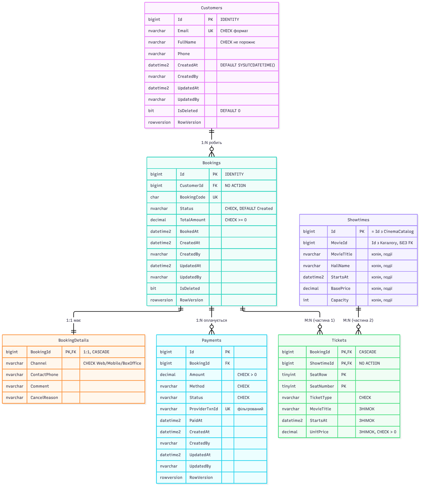
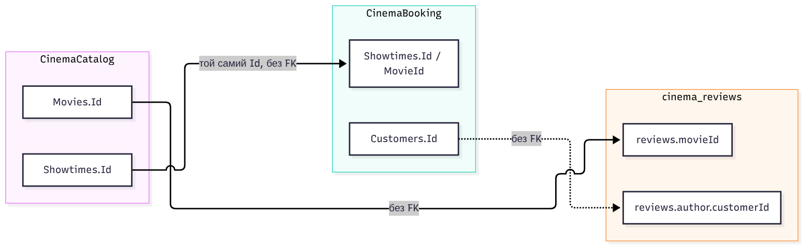

# Кінотеатр: мікросервісна платформа на .NET

Курс «Технології .NET». Один репозиторій на всі 10 лабораторних.

* **Лаб. 01:** проєктування баз даних для мікросервісної архітектури (цей README, `docs/`, `db/`)

## 1. Предметна область

Онлайн-система мережевого кінотеатру. **Глядачі** переглядають афішу й розклад, бронюють і оплачують квитки на конкретні місця, а після перегляду залишають відгуки та обговорюють фільми. **Адміністратори** ведуть каталог фільмів, залів і сеансів, **касири** перевіряють бронювання на вході в зал.

## 2. Три незалежні контексти (Bounded Contexts)

Кожен контекст це окремий мікросервіс з **власною БД**. Між базами немає спільних таблиць і **жодного FOREIGN KEY**: сутність іншого контексту відома лише за її Id (звичайний стовпець або поле).

| № | Контекст | БД | Технологія | Сутності (належать лише цьому контексту) |
|---|---|---|---|---|
| 1 | **Booking**: бронювання й оплата | `CinemaBooking` | SQL Server + ADO.NET & Dapper (Лаб. 02) | Customer, Booking, BookingDetail, Ticket, Payment (+ локальна копія Showtime) |
| 2 | **Catalog**: фільми, зали, розклад | `CinemaCatalog` | SQL Server + EF Core Code First (Лаб. 03) | Movie, MovieDetail, Genre, MovieGenre, Hall, Showtime |
| 3 | **Reviews**: відгуки й обговорення | `cinema_reviews` | MongoDB (Лаб. 04) | reviews (з вбудованими comments), discussions, discussionMessages, movieRatings |

Детально про контексти, агрегати й власників даних: [docs/contexts.md](docs/contexts.md).

## 3. Таблиця політики дублювання даних

Кожне поле, що дублюється між базами, має **одного власника**. Копія або є **знімком** (свідомо не оновлюється), або **оновлюється подіями** від власника (eventual consistency, механізм у Лаб. 08). Подвійного запису немає. FK на іншу базу немає ні для одного поля.

| Поле (копія) | Де зберігається | Джерело (власник даних) | Політика узгодженості |
|---|---|---|---|
| `Tickets.MovieTitle`, `Tickets.UnitPrice`, `Tickets.StartsAt` | CinemaBooking (P1) | `Movies.Title`, `Showtimes.Price`, `Showtimes.StartsAt` (CinemaCatalog) | **знімок** на момент бронювання, не оновлюється (квиток фіксує те, що купив глядач) |
| `Showtimes.MovieTitle`, `HallName`, `StartsAt`, `BasePrice`, `Capacity` (локальна копія сеансу, `Id` = Id з Каталогу) | CinemaBooking (P1) | `Showtimes` + `Movies` + `Halls` (CinemaCatalog) | **оновлюється подіями** `ShowtimeScheduled` / `ShowtimeChanged` з Каталогу; Booking ці поля не редагує |
| `reviews.movieTitle`, `discussions.movieTitle`, `movieRatings.movieTitle` | cinema_reviews (P3) | `Movies.Title` (CinemaCatalog) | **оновлюється подіями** `MovieRenamed` (`updateMany` за `movieId`) |
| `reviews.author.displayName`, `discussions.createdBy.displayName`, `discussionMessages.author.displayName` | cinema_reviews (P3) | `Customers.FullName` (CinemaBooking) | **оновлюється подіями** `CustomerRenamed` |
| `reviews.verifiedViewer` | cinema_reviews (P3) | бронювання зі статусом `CheckedIn` (CinemaBooking) | **знімок** на момент написання відгуку, не оновлюється |
| `Movies.AverageRating`, `Movies.ReviewsCount` | CinemaCatalog (P2) | `movieRatings` (cinema_reviews) | **оновлюється подіями** `MovieRatingChanged` після перерахунку рейтингу |
| `discussions.recentMessages[]` (3 останні) | cinema_reviews (P3), всередині однієї БД | `discussionMessages` | оновлюється в тій самій операції, що додає повідомлення (`$push` + `$slice: -3`) |

Пари сервісів, що взаємодіють: Catalog → Booking, Catalog → Reviews, Booking → Reviews, Reviews → Catalog. Для кожної пари в таблиці є щонайменше один рядок.

## 4. Структура репозиторію

```
README.md                  опис домену, контексти, дублювання, розгортання
docs/
  contexts.md              межі контекстів, агрегати, власники даних
  erd.md                   ERD Проєктів №1 і №2 (+ erd-p1.png, erd-p2.png, cross-db-links.png)
  erd-p1.dbml, erd-p2.dbml ті самі ERD для імпорту в dbdiagram.io
  mongodb-documents.md     колекції, приклади документів, індекси, агрегації
db/
  docker-compose.yml       SQL Server 2022 + MongoDB 7 локально
  p1/  schema.sql · procedures.sql · seed.sql · checks.sql   (CinemaBooking)
  p2/  schema.sql · seed.sql                                 (CinemaCatalog)
  p3/  collections.js · seed.js · queries.js                 (cinema_reviews)
```

## 5. Розгортання з нуля

Потрібні **Docker** (або встановлені локально SQL Server 2019+ і MongoDB 6+) і термінал. Усі скрипти **ідемпотентні**: їх можна запускати повторно, вони не падають і не створюють дублікатів.

### 5.1. Запустити СУБД

```bash
# з кореня репозиторію
docker compose -f db/docker-compose.yml up -d
# зачекати ~20 секунд, поки SQL Server стартує
```

Пароль `sa` береться зі змінної `MSSQL_SA_PASSWORD` (за замовчуванням `Your_strong_Passw0rd`). Далі в командах використовується змінна `SA`:

```bash
SA='Your_strong_Passw0rd'
SQL="docker exec -i cinema-mssql /opt/mssql-tools18/bin/sqlcmd -C -S localhost -U sa -P $SA -b -f 65001"
```

> Без Docker ті самі файли можна виконати в SSMS / Azure Data Studio / `sqlcmd -i <файл>` у вказаному порядку.

### 5.2. Проєкт №1: CinemaBooking

```bash
$SQL -i /db/p1/schema.sql       # 1) створює БД CinemaBooking, таблиці, ключі, обмеження, індекси, view
$SQL -i /db/p1/procedures.sql   # 2) 6 збережуваних процедур
$SQL -i /db/p1/seed.sql         # 3) тестові дані (повторний запуск не дублює)
$SQL -i /db/p1/checks.sql       # 4) перевірка: FK, індекси, CRUD, транзакції, недопустимі переходи
```

### 5.3. Проєкт №2: CinemaCatalog

```bash
$SQL -i /db/p2/schema.sql       # 1) створює БД CinemaCatalog, 6 таблиць, ключі, індекси, view
$SQL -i /db/p2/seed.sql         # 2) довідникові дані: жанри, фільми, зали, сеанси
```

### 5.4. Проєкт №3: cinema_reviews (MongoDB)

```bash
docker exec cinema-mongo mongosh --quiet /db/p3/collections.js   # 1) колекції, $jsonSchema, індекси
docker exec cinema-mongo mongosh --quiet /db/p3/seed.js          # 2) документи (upsert за _id)
docker exec cinema-mongo mongosh --quiet /db/p3/queries.js       # 3) приклади запитів і агрегацій
```

### 5.5. Таблиця політики дублювання

Після розгортання див. розділ 3 цього README: кожне дубльоване поле, його власник і політика.

## 6. Проєкт №1: що всередині

**Таблиці (6):** `Customers`, `Bookings`, `BookingDetails`, `Tickets`, `Payments`, `Showtimes` (локальна копія).

| Зв'язок | Реалізація |
|---|---|
| 1:1 | `Bookings` ↔ `BookingDetails`: `BookingDetails.BookingId` одночасно PK і FK (`ON DELETE CASCADE`) |
| 1:N | `Customers` → `Bookings` (`NO ACTION`: клієнта з історією не видаляємо), `Bookings` → `Payments` |
| M:N | `Bookings` ↔ `Showtimes` через `Tickets` (два FK + місце, тип, знімок назви й ціни) |

**Обмеження:** PK на кожній таблиці; FK усередині БД; `UNIQUE` (`Email`, `BookingCode`, `ProviderTxnId`); `CHECK` (статуси, ціни > 0, формат email, місця > 0, канали, методи оплати); `DEFAULT` (статус `Created`, дати `SYSUTCDATETIME()`, `IsDeleted = 0`).

**Каскади усвідомлено:** `CASCADE` лише для частин агрегату (`BookingDetails`, `Tickets`), `NO ACTION` для клієнта, оплат і сеансів (історія та фінансові дані не мають зникати).

**Первинні ключі:** `BIGINT IDENTITY`, бо записи створює лише сервіс Booking (одне джерело, послідовна вставка, компактний кластерний індекс). `Showtimes.Id` без IDENTITY, бо це Id, згенерований Каталогом.

**Індекси (кожен під запит):**

| Індекс | Запит |
|---|---|
| `IX_Bookings_Customer_Status_Active` (фільтр `IsDeleted = 0`, INCLUDE) | «мої бронювання» клієнта за статусом, новіші першими, з пагінацією |
| `IX_Bookings_AwaitingPayment_BookedAt` (фільтр `Status = 'AwaitingPayment'`) | фонова задача: скасувати неоплачені бронювання старші за 15 хв |
| `IX_Tickets_Showtime_Seat` | схема залу (зайняті місця) і перевірка «місце вільне» в `usp_Booking_AddTicket` |
| `IX_Payments_Booking_Status` | історія оплат бронювання, перевірка оплати при переході в `Paid` |
| `IX_Showtimes_StartsAt` | розклад сеансів на дату для каси |
| `UX_Payments_ProviderTxnId` (unique, фільтр `IS NOT NULL`) | callback платіжної системи за Id транзакції + захист від повторного запису |

**Аудит, м'яке видалення, конкурентність:** `CreatedAt`, `CreatedBy`, `UpdatedAt`, `UpdatedBy`, `IsDeleted` у `Customers` і `Bookings`. `ROWVERSION` там, де можливий паралельний запис: `Customers` (профіль редагують клієнт і адміністратор), `Bookings` (статус одночасно змінюють каса, платіжний сервіс і клієнт), `Payments` (статус оплати змінюють callback провайдера і повернення коштів). `Payments` має аудит, але не має `IsDeleted`: фінансові записи не видаляються. `BookingDetails` змінюється лише разом з бронюванням (його аудит і `RowVersion` у `Bookings`), `Tickets` це незмінний знімок (лише `CreatedAt`). Процедури приймають очікуваний `RowVersion` і відмовляють помилкою `50011`, якщо запис уже змінив хтось інший, тому зміни не затираються «тихо».

**Збережувані процедури (6):**

| Процедура | Тип | Що робить |
|---|---|---|
| `usp_Customer_Upsert` | CRUD | створює або оновлює клієнта (оновлення з перевіркою `RowVersion`) |
| `usp_Booking_GetById` | CRUD (read) | бронювання + деталі, квитки, оплати (3 набори результатів) |
| `usp_Booking_SoftDelete` | CRUD (delete) | м'яке видалення, лише для скасованих |
| `usp_Booking_Create` | бізнес, транзакція | `Bookings` + `BookingDetails` атомарно |
| `usp_Booking_AddTicket` | бізнес, транзакція | перевіряє, що місце вільне (`UPDLOCK, HOLDLOCK`), робить знімок назви й ціни, перераховує суму |
| `usp_Booking_ChangeStatus` | бізнес, транзакція | **зміна статусу з перевіркою переходу** |

Допустимі переходи статусу (`usp_Booking_ChangeStatus`, явна транзакція, `SET XACT_ABORT ON`, `UPDLOCK` на рядок):

```
Created ──► AwaitingPayment ──► Paid ──► CheckedIn
   │               │
   └──► Cancelled ◄┘          (скасування лише ДО оплати)
```

Недопустимий перехід (наприклад, `AwaitingPayment → CheckedIn`, тобто пропустити в зал неоплачене бронювання, або `Paid → Cancelled`) завершується **керованою помилкою** `THROW 50002 'Invalid status transition: ...'`, транзакція відкочується, статус не змінюється. Додаткові бізнес-перевірки: `50040` (немає квитків), `50041` (не оплачено повністю), `50042` (check-in раніше ніж за годину до сеансу).

## 7. Проєкт №2: що всередині

**Сутності (6):** `Genre`, `Movie`, `MovieDetail`, `MovieGenre`, `Hall`, `Showtime`.

| Зв'язок | Реалізація |
|---|---|
| 1:1 | `Movies` ↔ `MovieDetails` (`MovieId` є PK і FK) |
| 1:N | `Movies` → `Showtimes`, `Halls` → `Showtimes` |
| M:N | `Movies` ↔ `Genres` через `MovieGenres` з **власними полями** `AddedAt` (дата додавання фільму в жанр) і `IsPrimary` |

Унікальні поля: `Genres.Name`, `Genres.Slug`, `Movies(Title, ReleaseYear)`, `Halls.Name`, `Showtimes(HallId, StartsAt)` (у залі не може бути двох сеансів одночасно), один основний жанр на фільм (фільтрований unique). CHECK: ціни > 0, рік, тривалість, віковий рейтинг, формат залу, мова. Індекси під запити: афіша за рейтингом, розклад фільму, фільми жанру.

**Готовність до міграцій:** іменування PK/FK/IX у конвенціях EF Core. У Лаб. 03 модель описується Fluent API, seed-дані задаються через `HasData`, а схема створюється й надалі змінюється міграціями (`dotnet ef migrations add InitialCatalog`, `dotnet ef database update`). `db/p2/schema.sql` це спроєктована цільова схема для перевірки.

## 8. Проєкт №3: що всередині

4 колекції: `reviews`, `discussions`, `discussionMessages`, `movieRatings`.

* **Embedding:** `reviews.author`, `reviews.comments[]`, `reviews.criticInfo`
* **Referencing:** `reviews.discussionId` → `discussions`, `discussionMessages.discussionId` → `discussions`
* **Гібрид:** `discussions.recentMessages[]` (3 останні вбудовані) + повна історія в `discussionMessages`
* **Гнучка схема:** у `reviews` документи типу `viewer`, `quick`, `critic` мають різні набори полів
* **Денормалізація:** `movieTitle`, `author.displayName` (див. таблицю дублювання), read-модель `movieRatings`
* `$jsonSchema`-валідація, індекси під запити, aggregation pipeline: [docs/mongodb-documents.md](docs/mongodb-documents.md), `db/p3/queries.js`

## 9. ERD

### Проєкт №1 · CinemaBooking



### Проєкт №2 · CinemaCatalog


### Логічні посилання між базами (без FOREIGN KEY)



Код діаграм (Mermaid) і пояснення зв'язків:

* Проєкт №1: [docs/erd.md](docs/erd.md#проєкт-1--cinemabooking-sql-server-adonet--dapper), зображення `docs/erd-p1.png`
* Проєкт №2: [docs/erd.md](docs/erd.md#проєкт-2--cinemacatalog-sql-server-ef-core), зображення `docs/erd-p2.png`
* DBML для dbdiagram.io: `docs/erd-p1.dbml`, `docs/erd-p2.dbml`

## 10. Самоперевірка перед здачею

```bash
# 1) FK лише всередині своєї БД (жодного посилання на іншу базу)
$SQL -Q "USE CinemaBooking; SELECT name, OBJECT_NAME(referenced_object_id) FROM sys.foreign_keys"
$SQL -Q "USE CinemaCatalog; SELECT name, OBJECT_NAME(referenced_object_id) FROM sys.foreign_keys"

# 2) недопустимий перехід статусу -> керована помилка 50002, статус не змінюється
$SQL -I -Q "USE CinemaBooking; DECLARE @id BIGINT = (SELECT Id FROM Bookings WHERE BookingCode='SEED0002');
            EXEC usp_Booking_ChangeStatus @BookingId=@id, @NewStatus=N'CheckedIn'"

# 3) у MongoDB документи з різними наборами полів
docker exec cinema-mongo mongosh --quiet --eval 'db.getSiblingDB("cinema_reviews").reviews.find().toArray()'

# 4) повторний seed не створює дублікатів (кількість рядків не змінюється)
$SQL -i /db/p1/seed.sql && $SQL -i /db/p2/seed.sql
docker exec cinema-mongo mongosh --quiet /db/p3/seed.js
```
