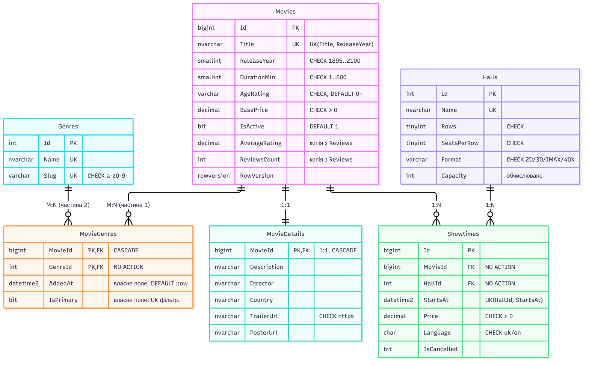
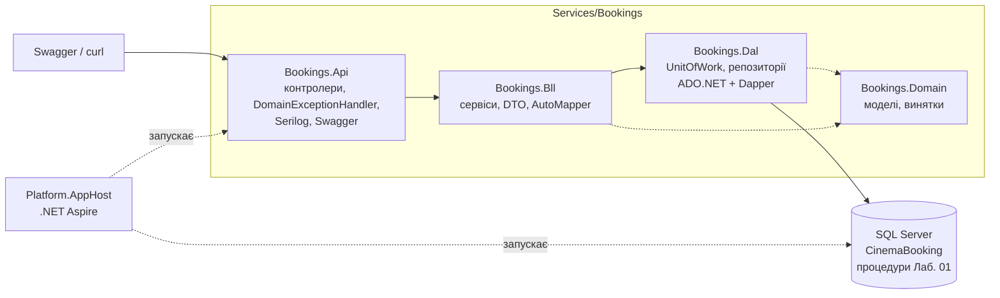
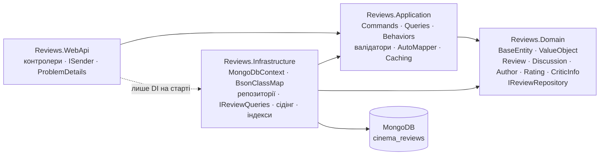
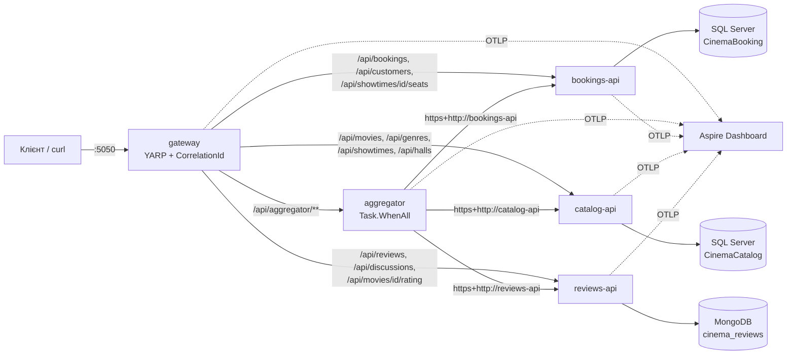

# Кінотеатр: мікросервісна платформа на .NET

Курс «Технології .NET». Один репозиторій на всі 10 лабораторних.

* **Лаб. 01:** проєктування баз даних для мікросервісної архітектури (`docs/`, `db/`)
* **Лаб. 02:** мікросервіс бронювань `Services/Bookings`: тришарова архітектура (Api → Bll → Dal) на ADO.NET та Dapper, запуск через .NET Aspire (`Platform.AppHost`)
* **Лаб. 03:** мікросервіс каталогу `Services/Catalog`: тришарова архітектура на EF Core (Code First, Fluent API, міграції, Generic Repository + Unit of Work, Specification pattern, FluentValidation, Serilog)
* **Лаб. 04:** мікросервіс відгуків `Services/Reviews`: Clean Architecture (Domain / Application / Infrastructure / WebApi), CQRS на MediatR з pipeline behaviors, MongoDB (BsonClassMap, оптимістична конкурентність, індекси, сідінг)
* **Лаб. 05:** платформа на .NET Aspire: `Platform.ServiceDefaults` (Serilog, OpenTelemetry, CorrelationId), API Gateway на YARP (`Platform.ApiGateway`, **http://localhost:5050**), `Platform.Aggregator` (картка бронювання з трьох сервісів), див. [розділ 14](#14-лаб-05-мікросервісна-платформа-на-net-aspire-yarp-gateway-aggregator-opentelemetry-serilog)
* **Лаб. 06:** gRPC-API в усіх сервісах (`Protos/*.proto`, `Grpc/`), Aggregator на gRPC з кешем у Redis, дворівневий кеш каталогу L1 (пам'ять) → L2 (Redis), метрики `cache.hits`/`cache.misses`, див. [розділ 15](#15-лаб-06-grpc-між-сервісами-і-дворівневе-кешування-memory--redis)

## Швидкий старт: уся платформа однією командою (.NET Aspire)

**Що потрібно:** .NET 10 SDK, Docker Desktop (запущений), IDE (Rider / Visual Studio / VS Code) або термінал.

```bash
git clone https://github.com/aanastasiaakk/cinema-microservices.git
cd cinema-microservices
dotnet run --project Platform.AppHost
```

У Rider: оберіть конфігурацію запуску **Platform.AppHost** → Run.

**Єдина точка входу — API Gateway: http://localhost:5050** (наприклад, `curl -i http://localhost:5050/api/aggregator/bookings/1/full`). Подробиці про платформу, Gateway й Aggregator див. у [розділі 14](#14-лаб-05-мікросервісна-платформа-на-net-aspire-yarp-gateway-aggregator-opentelemetry-serilog).

Aspire піднімає контейнер **SQL Server** (ресурс `sql`, бази `CinemaBooking` і `CinemaCatalog`), **Bookings API** (ресурс `bookings-api`) і **Catalog API** (ресурс `catalog-api`, Лаб. 03: схему створює міграція EF Core, див. [розділ 12](#12-лаб-03-мікросервіс-каталогу-на-ef-core-servicescatalog)), а також контейнер **MongoDB** (ресурс `mongo`, база `cinema_reviews`) і **Reviews API** (ресурс `reviews-api`, Лаб. 04: індекси й початкові дані створює сам сервіс, див. [розділ 13](#13-лаб-04-мікросервіс-відгуків-servicesreviews-clean-architecture-cqrs-mediatr-mongodb)). API стартує лише після того, як база готова (`WaitFor`), і при першому запуску застосовує до порожньої бази скрипти Лаб. 01 `db/p1/schema.sql → procedures.sql → seed.sql` (вони ідемпотентні). Посилання на **Aspire Dashboard** друкується в консолі. У Dashboard обидва ресурси мають бути в статусі **Running**; клікніть адресу `bookings-api`, щоб відкрити **Swagger** (`/swagger`).

Детально про сервіс, схему рішення й приклади запитів див. [розділ 11](#11-лаб-02-мікросервіс-бронювань-servicesbookings).

## 1. Предметна область

Онлайн-система мережевого кінотеатру. **Глядачі** переглядають афішу й розклад, бронюють і оплачують квитки на конкретні місця, а після перегляду залишають відгуки та обговорюють фільми. **Адміністратори** ведуть каталог фільмів, залів і сеансів, **касири** перевіряють бронювання на вході в зал.

## 2. Три незалежні контексти (Bounded Contexts)

Кожен контекст це окремий мікросервіс з **власною БД**. Між базами немає спільних таблиць і **жодного FOREIGN KEY**: сутність іншого контексту відома лише за її Id (звичайний стовпець або поле).

| № | Контекст | БД | Технологія | Сутності (належать лише цьому контексту) |
|---|---|---|---|---|
| 1 | **Booking**: бронювання й оплата | `CinemaBooking` | SQL Server + ADO.NET & Dapper (Лаб. 02) | Customer, Booking, BookingDetail, Ticket, Payment (+ локальна копія Showtime) |
| 2 | **Catalog**: фільми, зали, розклад | `CinemaCatalog` | SQL Server + EF Core Code First (Лаб. 03) | Movie, MovieDetail, Genre, MovieGenre, Hall, Showtime |
| 3 | **Reviews**: відгуки й обговорення | `cinema_reviews` | MongoDB (Лаб. 04) | reviews (з вбудованими comments), discussions, discussionMessages, movieRatings |

Детально про контексти, агрегати й власників даних: [docs/contexts.md](docs/contexts.md).

## 3. Таблиця політики дублювання даних

Кожне поле, що дублюється між базами, має **одного власника**. Копія або є **знімком** (свідомо не оновлюється), або **оновлюється подіями** від власника (eventual consistency, механізм у Лаб. 08). Подвійного запису немає. FK на іншу базу немає ні для одного поля.

| Поле (копія) | Де зберігається | Джерело (власник даних) | Політика узгодженості |
|---|---|---|---|
| `Tickets.MovieTitle`, `Tickets.UnitPrice`, `Tickets.StartsAt` | CinemaBooking (P1) | `Movies.Title`, `Showtimes.Price`, `Showtimes.StartsAt` (CinemaCatalog) | **знімок** на момент бронювання, не оновлюється (квиток фіксує те, що купив глядач) |
| `Showtimes.MovieTitle`, `HallName`, `StartsAt`, `BasePrice`, `Capacity` (локальна копія сеансу, `Id` = Id з Каталогу) | CinemaBooking (P1) | `Showtimes` + `Movies` + `Halls` (CinemaCatalog) | **оновлюється подіями** `ShowtimeScheduled` / `ShowtimeChanged` з Каталогу; Booking ці поля не редагує |
| `reviews.movieTitle`, `discussions.movieTitle`, `movieRatings.movieTitle` | cinema_reviews (P3) | `Movies.Title` (CinemaCatalog) | **оновлюється подіями** `MovieRenamed` (`updateMany` за `movieId`) |
| `reviews.author.displayName`, `discussions.createdBy.displayName`, `discussionMessages.author.displayName` | cinema_reviews (P3) | `Customers.FullName` (CinemaBooking) | **оновлюється подіями** `CustomerRenamed` |
| `reviews.verifiedViewer` | cinema_reviews (P3) | бронювання зі статусом `CheckedIn` (CinemaBooking) | **знімок** на момент написання відгуку, не оновлюється |
| `Movies.AverageRating`, `Movies.ReviewsCount` | CinemaCatalog (P2) | `movieRatings` (cinema_reviews) | **оновлюється подіями** `MovieRatingChanged` після перерахунку рейтингу |
| `discussions.recentMessages[]` (3 останні) | cinema_reviews (P3), всередині однієї БД | `discussionMessages` | оновлюється в тій самій операції, що додає повідомлення (`$push` + `$slice: -3`) |

Пари сервісів, що взаємодіють: Catalog → Booking, Catalog → Reviews, Booking → Reviews, Reviews → Catalog. Для кожної пари в таблиці є щонайменше один рядок.

## 4. Структура репозиторію

```
README.md                  опис домену, контексти, дублювання, розгортання, запуск
Platform.slnx              одне рішення на всю платформу
Platform.AppHost/          оркестрація .NET Aspire (AppHost.cs): БД → сервіси → Aggregator → Gateway
Platform.ServiceDefaults/  Extensions.cs (Serilog, OpenTelemetry, health, service discovery, resilience), CorrelationId.cs
Platform.ApiGateway/       YARP: маршрути й кластери (appsettings.json), CorrelationId, логування маршрутизації, Dockerfile
Platform.Aggregator/       typed HttpClients, картка бронювання (Task.WhenAll, часткові відмови)
Platform.Tests/            тести структури рішення й Aggregator
Services/
  Bookings/                Проєкт №1: мікросервіс бронювань (ADO.NET + Dapper)
    Bookings.Api/          контролери, middleware, Program.cs, appsettings.json
    Bookings.Bll/          сервіси, DTO, профілі AutoMapper
    Bookings.Dal/          інтерфейси репозиторіїв, ADO.NET/Dapper-реалізації, Unit of Work
    Bookings.Domain/       моделі, доменні винятки
    Bookings.Tests/        unit, integration і API-тести
  Catalog/                 Проєкт №2: мікросервіс каталогу (EF Core Code First)
    Catalog.Api/           контролери, middleware, Program.cs, appsettings*.json, Dockerfile, Protos/catalog.proto, Grpc/
    Catalog.Bll/           сервіси, DTO, профілі AutoMapper, Validation/, Specifications/, Caching/ (L1 → L2 → БД)
    Catalog.Dal/           DbContext, Configurations/, Migrations/, Repositories/, Seeding/, Unit of Work
    Catalog.Domain/        сутності з бізнес-правилами, доменні винятки
    Catalog.Tests/         unit-тести (домен, специфікації, валідатори) і integration-тести на SQL Server
  Reviews/                 Проєкт №3: мікросервіс відгуків (Clean Architecture + CQRS + MongoDB)
    Reviews.Domain/        Common/ (BaseEntity, ValueObject), Entities/, ValueObjects/, Exceptions/, Interfaces/
    Reviews.Application/   Common/ (Messaging, Behaviors, Interfaces, Models), Reviews/ і Discussions/ (Commands, Queries), Caching/, Mapping/
    Reviews.Infrastructure/ Persistence/ (MongoDbContext, MongoMappings, репозиторії, запити), Seeding/ (сідери, індекси)
    Reviews.WebApi/        Controllers/, Contracts/, Infrastructure/ (ProblemDetails), Program.cs, appsettings*.json
    Reviews.Tests/         unit-тести (домен, архітектура, BSON, pipeline) і integration-тести на MongoDB
docs/
  contexts.md              межі контекстів, агрегати, власники даних
  erd.md                   ERD Проєктів №1 і №2 (+ erd-p1.png, erd-p2.png, cross-db-links.png)
  erd-p1.dbml, erd-p2.dbml ті самі ERD для імпорту в dbdiagram.io
  mongodb-documents.md     колекції, приклади документів, індекси, агрегації
db/
  docker-compose.yml       SQL Server 2022 + MongoDB 7 локально
  p1/  schema.sql · procedures.sql · seed.sql · checks.sql   (CinemaBooking)
  p2/  schema.sql · seed.sql                                 (CinemaCatalog)
  p3/  collections.js · seed.js · queries.js                 (cinema_reviews)
```

## 5. Розгортання з нуля

Потрібні **Docker** (або встановлені локально SQL Server 2019+ і MongoDB 6+) і термінал. Усі скрипти **ідемпотентні**: їх можна запускати повторно, вони не падають і не створюють дублікатів.

### 5.1. Запустити СУБД

```bash
# з кореня репозиторію
docker compose -f db/docker-compose.yml up -d
# зачекати ~20 секунд, поки SQL Server стартує
```

Пароль `sa` береться зі змінної `MSSQL_SA_PASSWORD` (за замовчуванням `Your_strong_Passw0rd`). Далі в командах використовується змінна `SA`:

```bash
SA='Your_strong_Passw0rd'
SQL="docker exec -i cinema-mssql /opt/mssql-tools18/bin/sqlcmd -C -S localhost -U sa -P $SA -b -f 65001"
```

> Без Docker ті самі файли можна виконати в SSMS / Azure Data Studio / `sqlcmd -i <файл>` у вказаному порядку.

### 5.2. Проєкт №1: CinemaBooking

```bash
$SQL -i /db/p1/schema.sql       # 1) створює БД CinemaBooking, таблиці, ключі, обмеження, індекси, view
$SQL -i /db/p1/procedures.sql   # 2) 6 збережуваних процедур
$SQL -i /db/p1/seed.sql         # 3) тестові дані (повторний запуск не дублює)
$SQL -i /db/p1/checks.sql       # 4) перевірка: FK, індекси, CRUD, транзакції, недопустимі переходи
```

### 5.3. Проєкт №2: CinemaCatalog

```bash
$SQL -i /db/p2/schema.sql       # 1) створює БД CinemaCatalog, 6 таблиць, ключі, індекси, view
$SQL -i /db/p2/seed.sql         # 2) довідникові дані: жанри, фільми, зали, сеанси
```

### 5.4. Проєкт №3: cinema_reviews (MongoDB)

```bash
docker exec cinema-mongo mongosh --quiet /db/p3/collections.js   # 1) колекції, $jsonSchema, індекси
docker exec cinema-mongo mongosh --quiet /db/p3/seed.js          # 2) документи (upsert за _id)
docker exec cinema-mongo mongosh --quiet /db/p3/queries.js       # 3) приклади запитів і агрегацій
```

### 5.5. Таблиця політики дублювання

Після розгортання див. розділ 3 цього README: кожне дубльоване поле, його власник і політика.

## 6. Проєкт №1: що всередині

**Таблиці (6):** `Customers`, `Bookings`, `BookingDetails`, `Tickets`, `Payments`, `Showtimes` (локальна копія).

| Зв'язок | Реалізація |
|---|---|
| 1:1 | `Bookings` ↔ `BookingDetails`: `BookingDetails.BookingId` одночасно PK і FK (`ON DELETE CASCADE`) |
| 1:N | `Customers` → `Bookings` (`NO ACTION`: клієнта з історією не видаляємо), `Bookings` → `Payments` |
| M:N | `Bookings` ↔ `Showtimes` через `Tickets` (два FK + місце, тип, знімок назви й ціни) |

**Обмеження:** PK на кожній таблиці; FK усередині БД; `UNIQUE` (`Email`, `BookingCode`, `ProviderTxnId`); `CHECK` (статуси, ціни > 0, формат email, місця > 0, канали, методи оплати); `DEFAULT` (статус `Created`, дати `SYSUTCDATETIME()`, `IsDeleted = 0`).

**Каскади усвідомлено:** `CASCADE` лише для частин агрегату (`BookingDetails`, `Tickets`), `NO ACTION` для клієнта, оплат і сеансів (історія та фінансові дані не мають зникати).

**Первинні ключі:** `BIGINT IDENTITY`, бо записи створює лише сервіс Booking (одне джерело, послідовна вставка, компактний кластерний індекс). `Showtimes.Id` без IDENTITY, бо це Id, згенерований Каталогом.

**Індекси (кожен під запит):**

| Індекс | Запит |
|---|---|
| `IX_Bookings_Customer_Status_Active` (фільтр `IsDeleted = 0`, INCLUDE) | «мої бронювання» клієнта за статусом, новіші першими, з пагінацією |
| `IX_Bookings_AwaitingPayment_BookedAt` (фільтр `Status = 'AwaitingPayment'`) | фонова задача: скасувати неоплачені бронювання старші за 15 хв |
| `IX_Tickets_Showtime_Seat` | схема залу (зайняті місця) і перевірка «місце вільне» в `usp_Booking_AddTicket` |
| `IX_Payments_Booking_Status` | історія оплат бронювання, перевірка оплати при переході в `Paid` |
| `IX_Showtimes_StartsAt` | розклад сеансів на дату для каси |
| `UX_Payments_ProviderTxnId` (unique, фільтр `IS NOT NULL`) | callback платіжної системи за Id транзакції + захист від повторного запису |

**Аудит, м'яке видалення, конкурентність:** `CreatedAt`, `CreatedBy`, `UpdatedAt`, `UpdatedBy`, `IsDeleted` у `Customers` і `Bookings`. `ROWVERSION` там, де можливий паралельний запис: `Customers` (профіль редагують клієнт і адміністратор), `Bookings` (статус одночасно змінюють каса, платіжний сервіс і клієнт), `Payments` (статус оплати змінюють callback провайдера і повернення коштів). `Payments` має аудит, але не має `IsDeleted`: фінансові записи не видаляються. `BookingDetails` змінюється лише разом з бронюванням (його аудит і `RowVersion` у `Bookings`), `Tickets` це незмінний знімок (лише `CreatedAt`). Процедури приймають очікуваний `RowVersion` і відмовляють помилкою `50011`, якщо запис уже змінив хтось інший, тому зміни не затираються «тихо».

**Збережувані процедури (6):**

| Процедура | Тип | Що робить |
|---|---|---|
| `usp_Customer_Upsert` | CRUD | створює або оновлює клієнта (оновлення з перевіркою `RowVersion`) |
| `usp_Booking_GetById` | CRUD (read) | бронювання + деталі, квитки, оплати (3 набори результатів) |
| `usp_Booking_SoftDelete` | CRUD (delete) | м'яке видалення, лише для скасованих |
| `usp_Booking_Create` | бізнес, транзакція | `Bookings` + `BookingDetails` атомарно |
| `usp_Booking_AddTicket` | бізнес, транзакція | перевіряє, що місце вільне (`UPDLOCK, HOLDLOCK`), робить знімок назви й ціни, перераховує суму |
| `usp_Booking_ChangeStatus` | бізнес, транзакція | **зміна статусу з перевіркою переходу** |

Допустимі переходи статусу (`usp_Booking_ChangeStatus`, явна транзакція, `SET XACT_ABORT ON`, `UPDLOCK` на рядок):

```
Created ──► AwaitingPayment ──► Paid ──► CheckedIn
   │               │
   └──► Cancelled ◄┘          (скасування лише ДО оплати)
```

Недопустимий перехід (наприклад, `AwaitingPayment → CheckedIn`, тобто пропустити в зал неоплачене бронювання, або `Paid → Cancelled`) завершується **керованою помилкою** `THROW 50002 'Invalid status transition: ...'`, транзакція відкочується, статус не змінюється. Додаткові бізнес-перевірки: `50040` (немає квитків), `50041` (не оплачено повністю), `50042` (check-in раніше ніж за годину до сеансу).

## 7. Проєкт №2: що всередині

**Сутності (6):** `Genre`, `Movie`, `MovieDetail`, `MovieGenre`, `Hall`, `Showtime`.

| Зв'язок | Реалізація |
|---|---|
| 1:1 | `Movies` ↔ `MovieDetails` (`MovieId` є PK і FK) |
| 1:N | `Movies` → `Showtimes`, `Halls` → `Showtimes` |
| M:N | `Movies` ↔ `Genres` через `MovieGenres` з **власними полями** `AddedAt` (дата додавання фільму в жанр) і `IsPrimary` |

Унікальні поля: `Genres.Name`, `Genres.Slug`, `Movies(Title, ReleaseYear)`, `Halls.Name`, `Showtimes(HallId, StartsAt)` (у залі не може бути двох сеансів одночасно), один основний жанр на фільм (фільтрований unique). CHECK: ціни > 0, рік, тривалість, віковий рейтинг, формат залу, мова. Індекси під запити: афіша за рейтингом, розклад фільму, фільми жанру.

**Готовність до міграцій:** іменування PK/FK/IX у конвенціях EF Core. У Лаб. 03 модель описується Fluent API, seed-дані задаються через `HasData`, а схема створюється й надалі змінюється міграціями (`dotnet ef migrations add InitialCreate`, `dotnet ef database update`, реалізовано в [розділі 12](#12-лаб-03-мікросервіс-каталогу-на-ef-core-servicescatalog)). `db/p2/schema.sql` це спроєктована цільова схема для перевірки.

## 8. Проєкт №3: що всередині

4 колекції: `reviews`, `discussions`, `discussionMessages`, `movieRatings`.

* **Embedding:** `reviews.author`, `reviews.comments[]`, `reviews.criticInfo`
* **Referencing:** `reviews.discussionId` → `discussions`, `discussionMessages.discussionId` → `discussions`
* **Гібрид:** `discussions.recentMessages[]` (3 останні вбудовані) + повна історія в `discussionMessages`
* **Гнучка схема:** у `reviews` документи типу `viewer`, `quick`, `critic` мають різні набори полів
* **Денормалізація:** `movieTitle`, `author.displayName` (див. таблицю дублювання), read-модель `movieRatings`
* `$jsonSchema`-валідація, індекси під запити, aggregation pipeline: [docs/mongodb-documents.md](docs/mongodb-documents.md), `db/p3/queries.js`

## 9. ERD

### Проєкт №1 · CinemaBooking


### Проєкт №2 · CinemaCatalog



### Логічні посилання між базами (без FOREIGN KEY)


Код діаграм (Mermaid) і пояснення зв'язків:

* Проєкт №1: [docs/erd.md](docs/erd.md#проєкт-1--cinemabooking-sql-server-adonet--dapper), зображення `docs/erd-p1.png`
* Проєкт №2: [docs/erd.md](docs/erd.md#проєкт-2--cinemacatalog-sql-server-ef-core), зображення `docs/erd-p2.png`
* DBML для dbdiagram.io: `docs/erd-p1.dbml`, `docs/erd-p2.dbml`

## 10. Самоперевірка перед здачею

```bash
# 1) FK лише всередині своєї БД (жодного посилання на іншу базу)
$SQL -Q "USE CinemaBooking; SELECT name, OBJECT_NAME(referenced_object_id) FROM sys.foreign_keys"
$SQL -Q "USE CinemaCatalog; SELECT name, OBJECT_NAME(referenced_object_id) FROM sys.foreign_keys"

# 2) недопустимий перехід статусу -> керована помилка 50002, статус не змінюється
$SQL -I -Q "USE CinemaBooking; DECLARE @id BIGINT = (SELECT Id FROM Bookings WHERE BookingCode='SEED0002');
            EXEC usp_Booking_ChangeStatus @BookingId=@id, @NewStatus=N'CheckedIn'"

# 3) у MongoDB документи з різними наборами полів
docker exec cinema-mongo mongosh --quiet --eval 'db.getSiblingDB("cinema_reviews").reviews.find().toArray()'

# 4) повторний seed не створює дублікатів (кількість рядків не змінюється)
$SQL -i /db/p1/seed.sql && $SQL -i /db/p2/seed.sql
docker exec cinema-mongo mongosh --quiet /db/p3/seed.js
```

## 11. Лаб. 02: мікросервіс бронювань (Services/Bookings)

Вертикальний зріз «від БД до API» для Проєкту №1 (`CinemaBooking`): **DAL → BLL → Web/API**.

### 11.1. Схема рішення



Залежності спрямовані в один бік: **Api → Bll → Dal**, а **Domain** підключають і Dal, і Bll. Контролер ніколи не звертається до репозиторію напряму, лише через сервіс. SQL є тільки в `Bookings.Dal`.

| Проєкт | Що всередині |
|---|---|
| `Bookings.Domain` | моделі `Customer`, `Booking`, `BookingDetails`, `Ticket`, `Showtime`, `Payment`; константи статусів; `NotFoundException`, `BusinessConflictException`, `ValidationException` |
| `Bookings.Dal` | `IGenericRepository<T>`; `ICustomerRepository`, `IBookingRepository`, `IShowtimeRepository`, `IPaymentRepository`; `RepositoryBase`; `BaseDapperRepository<T>`; `UnitOfWork`; `SqlErrorMapper`; `DatabaseInitializer` |
| `Bookings.Bll` | `CustomerService`, `BookingService`, `PaymentService`, `ShowtimeService`; DTO (`Dto/`); профілі AutoMapper (`Mapping/`) |
| `Bookings.Api` | `CustomersController`, `BookingsController`, `ShowtimesController`; `DomainExceptionHandler` (ProblemDetails); `CorrelationIdMiddleware`; `Program.cs` (DI, Serilog, Swagger) |
| `Bookings.Tests` | unit-тести BLL (Moq), перевірка AutoMapper, integration-тести UoW (відкат), API-тести (`WebApplicationFactory`) |

### 11.2. DAL: репозиторії і Unit of Work

| Репозиторій | Технологія | Що показує |
|---|---|---|
| `CustomerRepository` | **чистий ADO.NET** (`SqlCommand`, `SqlParameter` з типами, `SqlDataReader`) | ручне читання й мапінг, `OUTPUT INSERTED.Id`, оновлення з перевіркою `RowVersion`; **свідомо не успадковує** Generic Repository |
| `BookingRepository` | ADO.NET + **Dapper**, `BaseDapperRepository<Booking>` | multi-mapping (бронювання + деталі + квитки одним запитом), виклик процедур `usp_Booking_ChangeStatus` і `usp_Booking_SoftDelete`, блокування місця `UPDLOCK, HOLDLOCK` |
| `ShowtimeRepository` | ADO.NET + Dapper, `BaseDapperRepository<Showtime>` | розклад, зайняті місця (мапінг у кортежі) |
| `PaymentRepository` | ADO.NET + Dapper, `BaseDapperRepository<Payment>` | пошук за idempotency-ключем |

* **Generic Repository:** спільний CRUD (`GetByIdAsync`, `GetPageAsync`, `AddAsync`, `UpdateAsync`, `DeleteAsync`) написаний один раз у `BaseDapperRepository<T>`. Конкретні інтерфейси успадковують `IGenericRepository<T>` і додають лише специфічні запити.
* **Параметризація:** усі значення передаються тільки параметрами (`@Id`, `@Name`, ...). Ім'я таблиці в `BaseDapperRepository<T>` це константа з коду, а не вхідні дані. Перевірено: ім'я `O'Brien` і навіть `O'Brien; DROP TABLE x--` зберігаються як звичайний текст.
* **Звільнення ресурсів:** команди й reader-и в `await using`; з'єднання одне на запит, закривається в `UnitOfWork.DisposeAsync()` і повертається в пул SqlClient.
* **Unit of Work** (`Scoped`): одне `SqlConnection` на HTTP-запит, `BeginTransactionAsync(IsolationLevel)`, `CommitAsync`, `RollbackAsync`, `DisposeAsync`. Усі репозиторії отримують **спільне з'єднання і поточну транзакцію** через `Func<SqlTransaction?>`.
* **Рівень ізоляції і таймаути:** `ReadCommitted` (за замовчуванням SQL Server) плюс точкові блокування там, де потрібна гарантія (`UPDLOCK, HOLDLOCK` при перевірці місця, `UPDLOCK` у процедурі зміни статусу). Компроміс такий: `RepeatableRead`/`Serializable` прибирають більше аномалій читання, але довше тримають більше блокувань, і ризик взаємних блокувань (deadlock) різко зростає. Таймаут з'єднання 15 с (`Connect Timeout`), таймаут команд 30 с (`RepositoryBase.CommandTimeoutSeconds`).
* **Помилки БД → доменні винятки** (`SqlErrorMapper`): `THROW 50001/50012/50031` → `NotFoundException`; `50002` (недопустимий перехід) та інші бізнес-помилки процедур, а також `2601/2627` (UNIQUE) і `547` → `BusinessConflictException`. Сирі SQL-повідомлення в API не потрапляють.

### 11.3. BLL: транзакційні бізнес-операції

| Операція | Репозиторії в одній транзакції | Таблиці | Відкат, якщо... |
|---|---|---|---|
| `BookingService.CreateAsync` | Customers, Bookings, Showtimes | Bookings, BookingDetails, Tickets | будь-яке місце вже зайняте (409), сеанс не існує (404) або вже почався (409) |
| `PaymentService.PayAsync` | Payments, Bookings (процедура) | Payments, Bookings | процедура `usp_Booking_ChangeStatus` відмовляє (наприклад, бронювання ще не передане на оплату → `Created -> Paid`, 409): запис оплати відкочується |

* **Знімок за політикою дублювання Лаб. 01:** при створенні квитка назва фільму, час і ціна беруться з `Showtimes` і записуються в `Tickets` (студентський квиток коштує 80% ціни, дитячий 60%).
* **Idempotency:** `POST /api/bookings/{id}/payments` вимагає заголовок `Idempotency-Key`. Повтор з тим самим ключем повертає ту саму оплату (200) і **не списує гроші вдруге**. Ключ зберігається в `Payments.ProviderTxnId` (UNIQUE).
* **Конкурентність:** pessimistic для продажу місць (блокування рядків, бо конкуренція за популярні місця часта); optimistic (`RowVersion`) для профілю клієнта й переходу в `Paid`, бо там конфлікти рідкісні.
* **Валідація на двох рівнях:** DataAnnotations на DTO (`[Required]`, `[EmailAddress]`, `[Range]`, `[RegularExpression]`) відхиляють запит ще до сервісу (400). Бізнес-правила зі станом БД перевіряє сервіс: клієнт існує, email унікальний, місце вільне, сума оплати дорівнює сумі бронювання.
* **AutoMapper:** профілі `CustomerProfile`, `BookingProfile`, `PaymentProfile` у `Bookings.Bll/Mapping`, реєструються одним `AddAutoMapper(...)` у `Program.cs`. Конфігурацію перевіряє тест `AssertConfigurationIsValid`. Ключ Community-ліцензії (automapper.io) задається в `AutoMapper:LicenseKey`; без нього застосунок працює, лише пише попередження в лог.

### 11.4. API: ендпоінти і статуси

| Метод | Шлях | Успіх | Помилки |
|---|---|---|---|
| GET | `/api/showtimes?days=90` | 200 | 400 |
| GET | `/api/showtimes/{id}` · `/api/showtimes/{id}/seats` | 200 | 404 |
| GET | `/api/customers?name=&page=&pageSize=` | 200 | 400 |
| GET | `/api/customers/{id}` | 200 | 404 |
| POST | `/api/customers` | **201** + Location | 400, 409 (email зайнятий) |
| PUT | `/api/customers/{id}` | 200 | 400, 404, 409 (застарілий RowVersion) |
| DELETE | `/api/customers/{id}` | **204** | 404, 409 (є активні бронювання) |
| GET | `/api/customers/{id}/bookings?status=` | 200 | 400, 404 |
| GET | `/api/bookings/{id}` | 200 | 404 |
| POST | `/api/bookings` | **201** + Location | 400, 404, 409 (місце зайняте) |
| POST | `/api/bookings/{id}/submit` | **204** | 404, 409 |
| POST | `/api/bookings/{id}/payments` (заголовок `Idempotency-Key`) | **201** / 200 (повтор) | 400, 404, 409 |
| GET | `/api/bookings/{id}/payments` | 200 | 404 |
| POST | `/api/bookings/{id}/check-in` | **204** | 404, 409 |
| POST | `/api/bookings/{id}/cancel` | **204** | 404, 409 (вже оплачене) |
| DELETE | `/api/bookings/{id}` | **204** | 404, 409 (не скасоване) |

Контролери тонкі: атрибутна маршрутизація, `async` + `CancellationToken` (передається в BLL і DAL), `ActionResult<T>`, `CreatedAtAction` для 201, `NoContent()` для 204. Жодного `try/catch`: усі винятки обробляє **один** глобальний `DomainExceptionHandler` і повертає **ProblemDetails** (RFC 9457) з `traceId`: `NotFoundException` → 404, `BusinessConflictException` → 409, `ValidationException` → 400, інше → 500 (без внутрішніх деталей). Кожен запис логу Serilog має `CorrelationId` (заголовок `X-Correlation-Id`).

### 11.5. Приклади запитів (curl)

Адресу API візьміть з Aspire Dashboard (нижче `$API`). Ті самі запити є у файлі `Services/Bookings/Bookings.Api/Bookings.Api.http`, який можна запускати прямо з Rider.

```bash
API=http://localhost:5080

# розклад і зайняті місця
curl "$API/api/showtimes?days=365"
curl "$API/api/showtimes/1/seats"

# клієнт з апострофом в імені -> 201 + Location (жодної помилки SQL)
curl -i -X POST "$API/api/customers" -H "Content-Type: application/json" \
     -d "{\"email\":\"conan.obrien@example.com\",\"fullName\":\"Conan O'Brien\"}"

# бронювання з двома квитками -> 201 (Bookings + BookingDetails + Tickets в одній транзакції)
curl -i -X POST "$API/api/bookings" -H "Content-Type: application/json" -d '{
  "customerId": 1, "channel": "Web",
  "tickets": [ {"showtimeId": 4, "seatRow": 9, "seatNumber": 1, "ticketType": "Adult"},
               {"showtimeId": 4, "seatRow": 9, "seatNumber": 2, "ticketType": "Student"} ] }'

# друге бронювання на вже зайняте місце -> 409, нічого не зберігається (відкат)
curl -i -X POST "$API/api/bookings" -H "Content-Type: application/json" \
     -d '{"customerId": 1, "tickets": [ {"showtimeId": 4, "seatRow": 9, "seatNumber": 1} ]}'

# передати на оплату -> 204; повторно -> 409 (Invalid status transition)
curl -i -X POST "$API/api/bookings/5/submit"

# оплата -> 201; той самий Idempotency-Key ще раз -> 200 і та сама оплата
curl -i -X POST "$API/api/bookings/5/payments" -H "Content-Type: application/json" \
     -H "Idempotency-Key: pay-5-001" -d '{"amount": 450.00, "method": "Card"}'

# скасувати оплачене бронювання -> 409 ProblemDetails
curl -i -X POST "$API/api/bookings/1/cancel" -H "Content-Type: application/json" -d '{"reason":"test"}'

# неіснуючий Id -> 404 ProblemDetails (а не 500)
curl -i "$API/api/bookings/999999"
```

Приклад відповіді 409:

```json
{
  "type": "https://tools.ietf.org/html/rfc9110#section-15.5.10",
  "title": "Business rule conflict",
  "status": 409,
  "detail": "Invalid status transition: Paid -> Cancelled",
  "instance": "/api/bookings/1/cancel",
  "traceId": "0HNQBOMMFFSSE:00000001"
}
```

### 11.6. Запуск без Aspire і тести

```bash
# база з Лаб. 01 у Docker (розділ 5), далі:
dotnet run --project Services/Bookings/Bookings.Api        # http://localhost:5080/swagger
# рядок підключення перевизначається змінною оточення:
# ConnectionStrings__CinemaBooking="Server=...;Database=CinemaBooking;..."

dotnet test Services/Bookings/Bookings.Tests               # unit-тести (без БД)
BOOKINGS_TEST_DB="Server=localhost,1433;Database=CinemaBooking;User Id=sa;Password=Your_strong_Passw0rd;TrustServerCertificate=True" \
  dotnet test Services/Bookings/Bookings.Tests             # + integration і API-тести проти БД
```

Тести: перевірка конфігурації AutoMapper; «оплата неіснуючого бронювання → `NotFoundException`»; зайняте місце → `BusinessConflictException` і `Rollback`, без `Commit`; знімок назви й ціни у квитку; повторна оплата з тим самим ключем не виконується; **відкат першого репозиторію при помилці в другому** (на справжній БД); `O'Brien`; API: 404 і 409 у форматі ProblemDetails, 400 на некоректний DTO.

### 11.7. Git

* `main` стабільна гілка, `develop` інтеграційна, `feature/<задача>` для окремих задач, `lab-NN` для здачі лабораторної.
* Зміни зливаються через Pull Request з описом; повідомлення комітів у форматі `<область>: <що зроблено>` (наприклад, `dal: add Unit of Work with shared transaction`).

## 12. Лаб. 03: мікросервіс каталогу на EF Core (Services/Catalog)

Реляційна база Проєкту №2 з Лаб. 01 (`CinemaCatalog`) тепер описана в коді (Code First). Схему створює міграція EF Core, а не скрипт `db/p2/schema.sql`. Структура рішення та сама, що в Лаб. 02 (Api → Bll → Dal → Domain), але доступ до даних побудовано на EF Core: моделі, Fluent API, міграції, LINQ to Entities.

### 12.1. Схема рішення

```mermaid
flowchart LR
    Client[Swagger / curl] --> Api
    subgraph Catalog.Api
      Api[Контролери] --> V[FluentValidation\n(явний виклик)]
      EH[GlobalExceptionHandler\nProblemDetails]
    end
    Api --> Bll
    subgraph Catalog.Bll
      Bll[MovieService · GenreService · ShowtimeService] --> Spec[Specifications]
      Bll --> Cache[Caching/ IMemoryCache]
      Bll --> AM[AutoMapper профілі]
    end
    Bll --> UoW
    subgraph Catalog.Dal
      UoW[UnitOfWork\nSaveChangesAsync] --> R[Movie / Genre / MovieGenre\nHall / Showtime репозиторії]
      R --> G[GenericRepository&lt;T&gt;\nDbSet + WithSpecification]
      G --> Ctx[CatalogDbContext\nApplyConfigurationsFromAssembly]
    end
    Ctx --> DB[(SQL Server\nCinemaCatalog)]
    Domain[Catalog.Domain\nсутності + винятки] -.-> Bll
    Domain -.-> Ctx
```

| Проєкт | Що всередині |
|---|---|
| `Catalog.Domain` | `Movie`, `MovieDetail` (1:1), `MovieGenre` (явна проміжна M:N з `AddedAt`, `IsPrimary`), `Genre`, `Hall`, `Showtime`; приватні setter-и, валідація в конструкторах, зміна стану лише методами (`ChangePrice`, `Deactivate`, `AddGenre`, `RemoveGenre`, `Cancel`…); винятки `DomainException`, `EntityNotFoundException`, `ConflictException`, `ValidationException` |
| `Catalog.Dal` | `CatalogDbContext`, окремий `IEntityTypeConfiguration<T>` на кожну сутність у `Configurations/` (підключені одним `ApplyConfigurationsFromAssembly`), `Migrations/` (`InitialCreate` + знімок моделі + `InitialCreate.sql`), `GenericRepository<T>`, три специфічні репозиторії, `UnitOfWork`, `Seeding/DbInitializer` |
| `Catalog.Bll` | сервіси, DTO, профілі AutoMapper, `Validation/` (FluentValidation), `Specifications/` (Ardalis.Specification), `Caching/` (кеш довідників) |
| `Catalog.Api` | тонкі асинхронні контролери, `GlobalExceptionHandler`, `CorrelationIdMiddleware`, Serilog, Swagger, `Dockerfile` |
| `Catalog.Tests` | unit-тести домену, специфікацій, валідаторів, AutoMapper; integration-тести на SQL Server (кількість SQL-запитів, ідемпотентний сідінг, пагінація в SQL) |

### 12.2. Модель і Fluent API

* **1:1** `Movie` ↔ `MovieDetail` (PK `MovieDetail.MovieId` є водночас FK, каскадне видалення).
* **1:N** `Movie` → `Showtimes`, `Hall` → `Showtimes` (`Restrict`: фільм або зал із сеансами не видаляється).
* **M:N** `Movie` ↔ `Genre` через **явну** сутність `MovieGenre`: складений ключ `(MovieId, GenreId)` і власні поля `AddedAt` та `IsPrimary`. Автоматичне M:N EF Core їх зберегти не дозволило б.
* Довжини рядків, `decimal(18,2)` для цін, унікальні індекси (`Genres.Name`, `Genres.Slug`, `Movies(Title, ReleaseYear)`, `Halls.Name`, `Showtimes(HallId, StartsAt)`, один основний жанр на фільм через фільтрований unique), CHECK-обмеження (ціна > 0, рік, тривалість, рейтинг, формат залу, мова), `rowversion` у `Movies`, обчислюване `Halls.Capacity`.

### 12.3. Міграції

```bash
dotnet tool install --global dotnet-ef        # один раз
cd Services/Catalog

# створити міграцію (уже створена: Catalog.Dal/Migrations/*_InitialCreate.cs)
dotnet ef migrations add InitialCreate --project Catalog.Dal --startup-project Catalog.Api --output-dir Migrations

# застосувати до БД з appsettings.json (або ConnectionStrings__CinemaCatalog=...)
dotnet ef database update --project Catalog.Dal --startup-project Catalog.Api

# SQL-скрипт міграції (у репозиторії: Catalog.Dal/Migrations/InitialCreate.sql, ідемпотентний)
dotnet ef migrations script --idempotent --project Catalog.Dal --startup-project Catalog.Api -o Catalog.Dal/Migrations/InitialCreate.sql
```

Під Aspire нічого запускати вручну не потрібно: на старті `Catalog.Api` викликає `MigrateAsync()`, а потім сідінг.

### 12.4. Сідінг (ідемпотентний)

* **Модельний (`HasData`)**: довідники з фіксованими Id, тобто жанри (1–6) і зали (1–2). Ці записи потрапляють у міграцію.
* **Програмний (`DbInitializer.SeedAsync`)** виконується після `MigrateAsync()` і вставляє фільми (з деталями й жанрами) та сеанси. Кожен запис перевіряється за природним ключем (`Title + ReleaseYear`, `HallId + StartsAt`), тому повторний запуск нічого не дублює, а в лозі з'являється `database already contains seed data`. На порожній БД Id фільмів 1–3 і сеансів 1–4 збігаються з Id, на які посилаються `CinemaBooking` і MongoDB.
* Сідінг вмикається і вимикається налаштуваннями `Database:MigrateOnStartup` і `Database:SeedOnStartup`. У `appsettings.Production.json` значення `SeedOnStartup = false`.

### 12.5. Репозиторії та Unit of Work

| Репозиторій | Спосіб завантаження | Метод | SQL-запитів |
|---|---|---|---|
| `GenericRepository<T>` | `DbSet<T>`: `GetByIdAsync`, `GetAllAsync`, `AddAsync` (async), `Update`/`Delete` (лише стан у контексті), `ListAsync(spec)`, `CountAsync(spec)` через `WithSpecification` | | |
| `MovieRepository` | **Eager Loading** (`Include` / `ThenInclude`): деталі, жанри, сеанси із залами | `GetWithDetailsAsync` | **1** |
| `GenreRepository` | **Explicit Loading**: жанр, потім `Entry(genre).Collection(g => g.MovieGenres).Query().Include(mg => mg.Movie).LoadAsync()` | `GetWithMoviesAsync` | **2** |
| `MovieGenreRepository` | **LINQ to Entities** через проміжну сутність і її власне поле `AddedAt` | `GetRecentlyAddedMoviesAsync`, `CountMoviesPerGenreAsync` | 1 |

`UnitOfWork` містить усі репозиторії над одним `CatalogDbContext` (Scoped) і єдиний `SaveChangesAsync()`. Репозиторії самі нічого не зберігають. Сервіс викликає `SaveChangesAsync()` один раз наприкінці операції, і, наприклад, `Movies + MovieDetails + MovieGenres` записуються однією транзакцією.

### 12.6. Пагінація, фільтрація, сортування, специфікації

* Запит: `page` (з 1), `pageSize` (за замовчуванням 20, максимум 100), фільтри `search`, `genre`, `year`, `ageRating`, `minPrice`, `maxPrice`, `isActive`, сортування `sortBy` = `title | year | price | rating | createdAt` (інші поля дають 400) і `sortDir` = `asc | desc`.
* Відповідь: `items`, `totalCount`, `page`, `pageSize`, `totalPages`, `hasNext`, `hasPrevious` у тілі. `totalCount` і `totalPages` дублюються в заголовках `X-Total-Count` і `X-Total-Pages`.
* Фільтр, сортування та `Skip/Take` описані в специфікації `MoviesFilterSpec` (Ardalis.Specification). Репозиторій лише застосовує її (`WithSpecification`), і база повертає тільки потрібну сторінку (`OFFSET … FETCH`). `totalCount` той самий об'єкт рахує як `COUNT(*)` за критеріями (`evaluateCriteriaOnly`).
* Друга специфікація `ShowtimesFilterSpec` (розклад: фільм, зал, період, скасовані, сортування `startsAt | price`) працює через той самий `GenericRepository` без змін у ньому.

### 12.7. Валідація й помилки

* **DataAnnotations** на DTO містять прості правила (`[Required]`, `[StringLength]`, `[Range]`). `[ApiController]` відхиляє некоректний запит з 400 ще до виклику сервісу.
* **FluentValidation** містить складні правила в окремих класах (`Validation/Validators.cs`): рік ≤ поточний + 5, рейтинг зі списку, https-трейлер, унікальні жанри, основний жанр серед вибраних, дозволені поля сортування, `maxPrice ≥ minPrice`, сеанс у майбутньому. Валідатори зареєстровані `AddValidatorsFromAssemblyContaining<…>()` і викликаються явно в контролерах. Застарілий `AddFluentValidation` не використовується. Обидва види помилок повертаються як `ValidationProblemDetails` з переліком по полях.
* **Правила з БД** перевіряє сервіс: дубль назви й року або назви жанру дає 409, зайнятий зал дає 409, неіснуючий жанр дає 400, неіснуючий фільм дає 404.
* **`GlobalExceptionHandler`** (`IExceptionHandler` + `AddProblemDetails`) — єдиний обробник: `EntityNotFoundException` → 404, `ValidationException` → 400, `ConflictException` і `DomainException` → 409, конфлікт `rowversion` і порушення унікального індексу → 409, інше → 500. Виняток логується один раз саме тут. Stack trace додається лише в Development.

### 12.8. Логування (Serilog)

* Налаштування в `appsettings.json`: рівні (`Default: Information`, `Microsoft.EntityFrameworkCore.Database.Command: Information`, щоб у лозі були SQL-команди EF Core), sink-и `Console` і `File` (`logs/catalog-*.json`, компактний JSON).
* Структуровані властивості: `CorrelationId` (заголовок `X-Correlation-Id`), `RequestPath`, `UserId`, `Service`, а також властивості повідомлень (`{MovieId}`, `{OldPrice}`, `{CacheKey}`…). `UseSerilogRequestLogging` пише один рядок на запит зі статусом і часом.
* Перевірка Eager/Explicit: надішліть `GET /api/movies/1` із заголовком `X-Correlation-Id: eager` і `GET /api/genres/2` із `X-Correlation-Id: explicit`. У `logs/catalog-*.json` для першого буде один `Executed DbCommand`, для другого два.

### 12.9. Ендпоінти

| Метод | Маршрут | Успіх | Помилки |
|---|---|---|---|
| GET | `/api/movies?page&pageSize&search&genre&year&ageRating&minPrice&maxPrice&isActive&sortBy&sortDir` | 200 | 400 |
| GET | `/api/movies/{id}` | 200 | 404 |
| POST | `/api/movies` | 201 + `Location` | 400, 409 |
| PUT | `/api/movies/{id}/price` | 204 | 400, 404, 409 |
| POST | `/api/movies/{id}/deactivate`, `/activate` | 204 | 404, 409 |
| POST / DELETE | `/api/movies/{id}/genres`, `/api/movies/{id}/genres/{genreId}` | 200 / 204 | 400, 404, 409 |
| DELETE | `/api/movies/{id}` | 204 | 404, 409 |
| GET | `/api/genres`, `/api/genres/{id}`, `/api/genres/{slug}/recent-movies?days`, `/api/genres/stats` | 200 | 404 |
| POST | `/api/genres` | 201 + `Location` | 400, 409 |
| GET | `/api/showtimes?movieId&hallId&from&to&includeCancelled&sortBy&sortDir&page&pageSize`, `/api/showtimes/{id}`, `/api/halls` | 200 | 400, 404 |
| POST | `/api/showtimes` | 201 + `Location` | 400, 404, 409 |
| POST | `/api/showtimes/{id}/cancel` | 204 | 404, 409 |

### 12.10. Приклади запитів (curl)

```bash
CAT=http://localhost:5090     # або адреса catalog-api з Aspire Dashboard

# пагінація + сортування: totalCount = усі фільми в БД, а не на сторінці
curl -i "$CAT/api/movies?page=2&pageSize=5&sortBy=price&sortDir=desc"
curl "$CAT/api/movies?genre=adventure&minPrice=100&maxPrice=200"

# eager (1 SQL) і explicit (2 SQL)
curl -H "X-Correlation-Id: eager" "$CAT/api/movies/1"
curl -H "X-Correlation-Id: explicit" "$CAT/api/genres/2"

# M:N через проміжну сутність і її поле AddedAt
curl "$CAT/api/genres/adventure/recent-movies?days=3650"

# створення -> 201 + Location; повтор -> 409
curl -i -X POST "$CAT/api/movies" -H "Content-Type: application/json" -d '{
  "title": "Будинок «Слово»", "releaseYear": 2021, "durationMin": 123, "ageRating": "16+",
  "basePrice": 160.00, "description": "Драма про харківський будинок письменників.",
  "genreIds": [1, 5], "primaryGenreId": 1 }'

# порожня назва -> 400 ValidationProblemDetails з помилками по полях (не 500)
curl -i -X POST "$CAT/api/movies" -H "Content-Type: application/json" \
  -d '{"title":"","releaseYear":2024,"durationMin":0,"ageRating":"0+","basePrice":0,"description":""}'

# неіснуючий Id -> 404 ProblemDetails
curl -i "$CAT/api/movies/999999"

# друга специфікація: розклад, дорожчі першими
curl "$CAT/api/showtimes?sortBy=price&sortDir=desc&pageSize=3"
```

Ті самі запити є у `Services/Catalog/Catalog.Api/Catalog.Api.http`.

### 12.11. Запуск без Aspire, Docker і тести

```bash
# SQL Server з Лаб. 01 (розділ 5.1), далі:
dotnet run --project Services/Catalog/Catalog.Api       # http://localhost:5090/swagger; міграція й сідінг на старті

# Docker-образ (контекст — корінь репозиторію)
docker build -f Services/Catalog/Catalog.Api/Dockerfile -t cinema/catalog-api .
docker run -p 8080:8080 \
  -e ConnectionStrings__CinemaCatalog="Server=host.docker.internal,1433;Database=CinemaCatalog;User Id=sa;Password=Your_strong_Passw0rd;TrustServerCertificate=True" \
  cinema/catalog-api

dotnet test Services/Catalog/Catalog.Tests                # unit-тести (без БД)
CATALOG_TEST_DB="Server=localhost,1433;Database=CinemaCatalogTests;User Id=sa;Password=Your_strong_Passw0rd;TrustServerCertificate=True" \
  dotnet test Services/Catalog/Catalog.Tests              # + integration: окрема тестова БД створюється міграцією
```

Integration-тести перевіряють: міграція створює складений ключ і CHECK ціни; повторний сідінг не дублює дані; Eager Loading виконує **1** SQL-запит, а Explicit Loading **2**; пагінація йде через `OFFSET … FETCH`, а `totalCount` дорівнює кількості всіх рядків; M:N-вибірка йде одним запитом через `MovieGenres`.

### 12.12. Знімки екрана для здачі (`docs/lab03/`)

Знято з працюючого сервісу (Aspire) на реальних відповідях API і реальному лозі Serilog:

* [01-swagger.png](docs/lab03/01-swagger.png): Swagger з усіма ендпоінтами;
* [02-pagination.png](docs/lab03/02-pagination.png): відповідь з пагінацією (`items`, `totalCount`, `totalPages`, `hasNext`, `hasPrevious` + заголовки `X-Total-*`);
* [03-validation-400.png](docs/lab03/03-validation-400.png): 400 `ValidationProblemDetails` з помилками по полях (DataAnnotations і FluentValidation);
* [04-sql-log-eager-explicit.png](docs/lab03/04-sql-log-eager-explicit.png): фрагмент логу з SQL-запитами: eager = 1 запит, explicit = 2;
* [05-errors-404-409.png](docs/lab03/05-errors-404-409.png): 404 і 409 у форматі ProblemDetails.

## 13. Лаб. 04: мікросервіс відгуків (Services/Reviews): Clean Architecture, CQRS (MediatR), MongoDB

База Проєкту №3 з Лаб. 01 (`cinema_reviews`, колекції `reviews` і `discussions`) тепер обслуговується мікросервісом із чотирьох шарів. Документи зберігають структуру з Лаб. 01: camelCase, вкладені `author`, `comments`, `criticInfo`, `recentMessages`, гнучка схема.

### 13.1. Шари і напрямок залежностей



| Проєкт | Посилання (`*.csproj`) | Пакети |
|---|---|---|
| `Reviews.Domain` | **жодних** | лише `MongoDB.Bson` (тип `ObjectId`), **без** `MongoDB.Driver` |
| `Reviews.Application` | `Reviews.Domain` | MediatR, FluentValidation(+DI), AutoMapper, Caching.Memory |
| `Reviews.Infrastructure` | `Reviews.Application`, `Reviews.Domain` | MongoDB.Driver, Options.ConfigurationExtensions |
| `Reviews.WebApi` | `Reviews.Application`, `Reviews.Infrastructure` | Swashbuckle, Serilog, HealthChecks.MongoDb |

Правило перевіряє тест `ArchitectureTests`, який читає самі `*.csproj`.

### 13.2. Домен

* `Common/BaseEntity`: `Id` (`ObjectId`), `CreatedAt`, `UpdatedAt`, `Version` (оптимістична конкурентність).
* `Common/ValueObject`: порівняння за значеннями через `GetEqualityComponents()`, оператори `==`/`!=`.
* Сутності `Review` (відгук) і `Discussion` (тема обговорення): приватні setter-и, валідація в конструкторах, зміна стану лише методами (`Edit`, `AddComment`, `Delete`, `LinkDiscussion`, `PostMessage`, `Close`). Вкладені колекції зберігаються в приватних полях (`_comments`, `_tags`, `_recentMessages`) і назовні видно лише `IReadOnlyCollection`.
* Value Objects (незмінні, без setter-ів, з валідацією): `Author` (customerId + displayName), `Rating` (1–5), `CriticInfo` (outlet + score100). Вони вбудовані в документи як `author`, `rating`, `criticInfo`.
* `Exceptions/`: `DomainException`, `NotFoundException`, `ConflictException`. `Interfaces/`: `IReviewRepository`, `IDiscussionRepository`.

### 13.3. CQRS з MediatR

* Базові `ICommand`, `ICommand<T>`, `IQuery<T>` (`Common/Messaging`).
* Команди (окремий файл на кожну: команда, валідатор, обробник через інтерфейс репозиторію, async): `CreateReview`, `UpdateReview`, `DeleteReview` (м'яке), `AddComment`, `CreateDiscussion`, `PostMessage`, `CloseDiscussion`.
* Запити: `GetReviewById`, `GetReviewsList`, `GetMovieRating` (кешується), `GetDiscussionById`, `GetDiscussionsList`. Обробники запитів викликають `IReviewQueries` / `IDiscussionQueries` (Application). Реалізація в Infrastructure робить aggregation pipeline `$match → $sort → $skip → $limit → $project` і десеріалізує результат одразу в DTO. Рейтинг рахується через `$match → $group`.
* Реєстрація (`AddApplication`): `AddMediatR` з `RegisterServicesFromAssembly` і `AddOpenBehavior` у порядку **Logging → Validation → Caching → Performance → обробник**, `AddValidatorsFromAssembly`, AutoMapper. У кожного шару свій метод розширення: `AddApplication`, `AddInfrastructure`.

### 13.4. Pipeline Behaviors

* `ValidationBehavior` запускає всі валідатори FluentValidation (для команд і запитів), збирає всі помилки разом і кидає `ValidationException` до виклику обробника. Перевіряється формат `ObjectId` (`MustBeObjectId`). Асинхронні правила з запитом до MongoDB: «цей глядач уже залишив відгук на фільм» (`IReviewRepository.ExistsAsync`) і «тема з такою назвою вже є».
* `LoggingBehavior` пише структуровані `Handling {RequestName} {@Request}`, `Handled …` або `… rejected`.
* `PerformanceBehavior` пише `Handler {RequestName} executed in {ElapsedMs} ms`, а повільніше за поріг `Performance:SlowRequestMs` (500 мс) пише попередження.
* `CachingBehavior` кешує запити, що реалізують `ICacheableQuery` (рейтинг фільму, 30 с). Команди скидають кеш через `ICacheInvalidator`.
* Перевірка «обробник не викликався»: для команди з `rating = 10` у лозі є `Handling CreateReviewCommand` і `CreateReviewCommand rejected: ValidationException`, але немає рядка `Handler CreateReviewCommand executed`.

### 13.5. MongoDB (Infrastructure)

* `MongoDbContext` отримує `IOptions<MongoDbOptions>` (секція `MongoDb`) і надає `IMongoCollection<Review>` / `IMongoCollection<Discussion>`. Клієнт singleton, пул і таймаути задаються в рядку підключення (`maxPoolSize`, `serverSelectionTimeoutMS`). Під Aspire рядок підключення приходить як `ConnectionStrings__reviewsdb`.
* `MongoMappings` описує мапінг без жодного атрибута в домені. Конвенції camelCase, `IgnoreExtraElements` (невідомі поля на кшталт `photos`, `pros` не ламають читання) і `IgnoreIfNull`. Приватні поля `_comments → comments`, `_tags → tags`. Value Objects створюються через конструктор (`MapCreator`). Власні серіалізатори: `Rating` → число, enum → рядок у нижньому регістрі (`"viewer"`, `"open"`). Для DTO читання `ObjectId` перетворюється на string. Мапінг реєструється один раз під час старту.
* Репозиторії на MongoDB Driver. `UpdateAsync(entity, expectedVersion)` виконує `updateOne({ _id, version: expected }, { $set: …, version: expected + 1 })`. Якщо документ уже змінили, `MatchedCount = 0` дає `ConflictException` (409). Документ не замінюється цілком, тож поля, яких немає в домені (гнучка схема), зберігаються.

### 13.6. Індекси, сідінг, конфігурація

* `IndexCreationService` (`IHostedService`, стартує першим) створює індекси (імена як у `db/p3/collections.js`):
  * складені: `ix_reviews_movie_createdAt` `{movieId:1, createdAt:-1}` (partial `isDeleted:false`), `ix_reviews_author`, `ix_discussions_movie_last`;
  * text: `tx_reviews_text` `{text:"text"}`;
  * unique: `ux_reviews_movie_author_viewer` (один відгук глядача на фільм, partial `type:"viewer"`) і `ux_discussions_movie_title`;
  * `ix_reviews_movie`, `ix_discussions_tags` (multikey).
  
  Повторне створення наявного індексу безпечне.
* `IDataSeeder` (`ReviewSeeder`, `DiscussionSeeder`) запускає `DataSeedingHostedService` після індексів. Якщо колекція не порожня, сідер нічого не робить, інакше виконує `InsertManyAsync`. Дані й `_id` ті самі, що в `db/p3/seed.js`.
* `appsettings.json` / `appsettings.Development.json` / `appsettings.Staging.json` / `appsettings.Production.json`, секція `MongoDb` (`ConnectionString`, `DatabaseName`, `SeedOnStartup`, `CreateIndexesOnStartup`). У Production сідінг вимкнено. Health check MongoDB доступний на `/health`.

### 13.7. Помилки (ProblemDetails)

| Виняток | HTTP |
|---|---|
| `NotFoundException` | 404 |
| `ValidationException` (FluentValidation) | 400, `ValidationProblemDetails` з помилками по полях |
| `DomainException` | 400 |
| `ConflictException` (у т. ч. конфлікт версій) | 409 |
| `MongoWriteException` DuplicateKey (інші помилки запису → 400) | 409 |
| `MongoConnectionException`, недоступний сервер (timeout вибору сервера) | 503 |
| інше | 500 (деталі лише в Development) |

### 13.8. Ендпоінти

| Метод | Маршрут | Успіх | Помилки |
|---|---|---|---|
| GET | `/api/reviews?movieId&customerId&type&minRating&search&sortBy&sortDir&page&pageSize` | 200 | 400 |
| GET | `/api/reviews/{id}` (ETag = версія) | 200 | 400, 404 |
| POST | `/api/reviews` | 201 + `Location: /api/reviews/{ObjectId}` | 400, 409 |
| PUT | `/api/reviews/{id}` (`If-Match: "версія"`) | 200 | 400, 404, 409 |
| DELETE | `/api/reviews/{id}` | 204 | 400, 404, 409 |
| POST | `/api/reviews/{id}/comments` | 200 | 400, 404, 409 |
| GET | `/api/movies/{movieId}/rating` | 200 | 400, 404 |
| GET | `/api/discussions?movieId&tag&page&pageSize`, `/api/discussions/{id}` | 200 | 400, 404 |
| POST | `/api/discussions` | 201 + `Location` | 400, 409 |
| POST | `/api/discussions/{id}/messages`, `/api/discussions/{id}/close` | 200 / 204 | 400, 404, 409 |

### 13.9. Запуск і приклади

Під Aspire (`dotnet run --project Platform.AppHost`) піднімається контейнер **MongoDB** (ресурс `mongo`, база `cinema_reviews`) і **Reviews API** (`reviews-api`). Сервіс сам створює індекси й наповнює базу. Без Aspire:

```bash
docker compose -f db/docker-compose.yml up -d mongo
dotnet run --project Services/Reviews/Reviews.WebApi        # http://localhost:5100/swagger
```

```bash
REV=http://localhost:5100

curl "$REV/api/reviews?movieId=1&sortBy=rating&sortDir=desc&page=1&pageSize=2"
curl "$REV/api/reviews?search=Карпат"                          # text-індекс
curl -i "$REV/api/reviews/6750c0000000000000000001"            # ETag: "1"
curl "$REV/api/movies/3/rating"                                # aggregation pipeline

# створення -> 201 + Location з рядковим ObjectId
curl -i -X POST "$REV/api/reviews" -H "Content-Type: application/json" -d '{
  "type":"viewer","movieId":2,"movieTitle":"Мавка. Лісова пісня","customerId":3,
  "authorName":"Ірина Бондар","rating":5,"text":"Дуже красиво!"}'

# той самий глядач на той самий фільм -> 400 (async-валідатор із запитом до MongoDB)
# rating = 10 -> 400 ще до обробника
curl -i -X POST "$REV/api/reviews" -H "Content-Type: application/json" -d '{
  "type":"viewer","movieId":1,"movieTitle":"Довбуш","customerId":9,"authorName":"Тест","rating":10,"text":"x"}'

# конфлікт версій -> 409
curl -i -X PUT "$REV/api/reviews/6750c0000000000000000005" -H 'If-Match: "99"' \
  -H "Content-Type: application/json" -d '{"rating":4,"text":"Передумала"}'

curl -i "$REV/api/reviews/6750c00000000000000000ff"             # 404
curl -i "$REV/api/reviews/not-an-id"                            # 400: Id must be a valid ObjectId
```

У mongosh:

```js
use cinema_reviews
db.reviews.find().limit(2)        // camelCase, вкладені author і comments, без приватних полів .NET
db.reviews.getIndexes()           // створені сервісом індекси
```

### 13.10. Тести

```bash
dotnet test Services/Reviews/Reviews.Tests                          # unit: домен, архітектура, BSON-мапінг, pipeline
REVIEWS_TEST_MONGO="mongodb://localhost:27017" dotnet test Services/Reviews/Reviews.Tests   # + integration на MongoDB
```

Unit-тести перевіряють: `Rating = 10` дає `DomainException` без БД; Value Objects порівнюються за значенням; `Reviews.Domain` не має посилань на проєкти й `MongoDB.Driver`; документ серіалізується в camelCase без приватних полів і десеріалізується через приватне поле та конструктори; проєкція одразу в DTO; команда з `rating = 10` і повторний відгук відхиляються до обробника, всі помилки збираються разом; невалідний `ObjectId` у запиті дає помилку; конфігурація AutoMapper коректна. Integration-тести (кожен в окремій тимчасовій БД) перевіряють: індекси (складений, text, unique); ідемпотентний сідінг; форму документа; конфлікт версій; збереження невідомих домену полів при оновленні; DuplicateKey на unique-індексі; пагінацію, text-пошук і рейтинг через aggregation.

### 13.11. Знімки екрана для здачі (`docs/lab04/`)

Знято з працюючого сервісу під Aspire, на реальних відповідях API, реальному вмісті MongoDB і реальному лозі:

* [01-swagger.png](docs/lab04/01-swagger.png): Swagger з усіма ендпоінтами;
* [02-mongo-document.png](docs/lab04/02-mongo-document.png): документ `reviews` (`db.reviews.findOne(...)` у mongosh; аналог перегляду в Compass);
* [03-get-indexes.png](docs/lab04/03-get-indexes.png): результат `db.reviews.getIndexes()`;
* [04-validation-before-handler.png](docs/lab04/04-validation-before-handler.png): 400 для `rating = 10` і лог, де видно, що обробник не викликався;
* [05-conflict-404.png](docs/lab04/05-conflict-404.png): конфлікт версій 409, повторний відгук 400, неіснуючий Id 404.

## 14. Лаб. 05: мікросервісна платформа на .NET Aspire (YARP Gateway, Aggregator, OpenTelemetry, Serilog)

Три мікросервіси з Лаб. 02–04 інтегровано в одну платформу. Її запускає одна команда, клієнт заходить через **API Gateway**, а **Aggregator** збирає картку бронювання з трьох сервісів. Логи й трасування всіх компонентів видно в Aspire Dashboard.

### 14.1. Запуск платформи

**Що потрібно:** .NET 10 SDK, запущений Docker Desktop.

```bash
dotnet run --project Platform.AppHost
```

* **Aspire Dashboard**: посилання з токеном друкується в консолі (`http://localhost:15080/login?t=…`).
* **API Gateway** (єдина точка входу): **http://localhost:5050**. Порт фіксований. 5000 не використано, бо на macOS його займає AirPlay Receiver.
* Пароль SQL Server — параметр-секрет `sql-password` (user-secrets AppHost: `Parameters:sql-password`). Якщо значення немає, Dashboard попросить ввести його під час першого запуску. Задати вручну можна так: `dotnet user-secrets set Parameters:sql-password '<пароль>' --project Platform.AppHost`.

Порядок старту (`WaitFor`): **SQL Server, MongoDB → bookings-api, catalog-api, reviews-api → aggregator → gateway**. У Dashboard усі 10 ресурсів мають бути в статусі Running.



### 14.2. Структура рішення і посилання

| Проєкт | Посилається на |
|---|---|
| `Platform.AppHost` | `Bookings.Api`, `Catalog.Api`, `Reviews.WebApi`, `Platform.Aggregator`, `Platform.ApiGateway` |
| `Platform.ServiceDefaults` | — (бібліотека) |
| `Platform.ApiGateway`, `Platform.Aggregator` | лише `Platform.ServiceDefaults` |
| `Bookings.Api`, `Catalog.Api`, `Reviews.WebApi` | свої шари + `Platform.ServiceDefaults` |

Ніхто не посилається на AppHost. Правила перевіряє `Platform.Tests/SolutionStructureTests`.

### 14.3. AppHost

* `AddSqlServer("sql", sqlPassword)` з параметром-секретом, `WithDataVolume("cinema-sql-data")`, бази `CinemaBooking` і `CinemaCatalog`. `AddMongoDB("mongo")` (`mongo:7`) з `WithDataVolume("cinema-mongo-data")`, база `reviewsdb` → `cinema_reviews`. Імена баз збігаються з іменами рядків підключення в `appsettings.json` сервісів, тож Aspire передає їх як `ConnectionStrings__<ім'я>`. Резервні рядки в `appsettings.json` лишилися для запуску без Aspire.
* Сервіси: `AddProject(...).WithReference(db).WaitFor(db)`. Aggregator робить `WithReference` + `WaitFor` на всі три сервіси. Gateway має `WithHttpEndpoint(port: 5050)` і `WithReference` на сервіси та Aggregator, а також `WaitFor(aggregator)`.

### 14.4. Інтеграція сервісів (мінімальні зміни)

У `Program.cs` кожного сервісу додано `builder.AddServiceDefaults()`, `app.UseCorrelationId()` і `app.MapDefaultEndpoints()` (`/health`, `/alive`). Власну конфігурацію Serilog і власний CorrelationId-middleware з Лаб. 02–04 прибрано, бо тепер вони в ServiceDefaults. Ендпоінти вже мали префікси `/api/{domain}`: `/api/bookings`, `/api/movies`, `/api/reviews`…

Бізнес-події логуються зі структурованими властивостями без персональних даних (`BookingId`, `CustomerId`, `TicketsCount`, `TotalAmount`, `Status`, `MovieId`, `ReviewId`, `Rating`…). Власні spans створюються через `ActivitySource`:

| Сервіс | ActivitySource | Spans |
|---|---|---|
| Bookings (`Bookings.Bll/Diagnostics`) | `Cinema.Bookings` | `CreateBooking`, `ChangeBookingStatus`, `PayBooking` |
| Catalog (`Catalog.Bll/Diagnostics`) | `Cinema.Catalog` | `CreateMovie`, `ChangeMoviePrice`, `ScheduleShowtime` |
| Reviews (`Reviews.Application/Common/Diagnostics`) | `Cinema.Reviews` | `CreateReview`, `UpdateReview`, `DeleteReview` |
| Aggregator | `Cinema.Aggregator` | `AggregateBookingCard` |

### 14.5. ServiceDefaults (`Platform.ServiceDefaults/Extensions.cs`, `CorrelationId.cs`)

* **Serilog** (`AddSerilog(..., writeToProviders: true)`): enrichers `ServiceName`, `EnvironmentName`, `MachineName`, `ThreadId`, `FromLogContext` (CorrelationId), `TraceId`/`SpanId` з поточного Activity. Рівень Debug у Development, Information в інших середовищах. EF Core, HttpClient, Polly й ASP.NET Core приглушені. Console пише у форматі `RenderedCompactJsonFormatter`. Завдяки `writeToProviders: true` записи йдуть і в провайдер OpenTelemetry, тобто у вкладку **Structured logs**. Секція `Serilog` в `appsettings.json` сервісу уточнює рівні: Catalog залишає SQL-команди EF Core з Лаб. 03.
* **CorrelationId**: `CorrelationIdMiddleware` бере `X-Correlation-Id` із запиту або генерує GUID і записує його в заголовки запиту (далі його бачать YARP і HttpClient), у відповідь, у `LogContext` і в тег span-а `correlation.id`. Межі запиту логуються. `CorrelationIdHandler` (`DelegatingHandler`) додає той самий заголовок до кожного вихідного HTTP-запиту.
* **OpenTelemetry**: інструментація ASP.NET Core (без `/health`, `/alive`), HttpClient, SqlClient (Dapper й EF Core), MongoDB (`MongoDB.Driver.Core.Extensions.DiagnosticSources`, підписка в `Reviews.Infrastructure`), власні `Cinema.*`. Метрики ASP.NET Core, HttpClient і runtime. Sampling: 100 % у Development, `OpenTelemetry:SamplingRatio` (0.25) в інших середовищах. Експорт через `UseOtlpExporter()` на адресу, яку задає Aspire.
* Також є health checks, service discovery і стандартна стійкість HttpClient (`AddStandardResilienceHandler`, детально в Лаб. 07).

### 14.6. API Gateway (`Platform.ApiGateway`)

* YARP: маршрути й кластери в `appsettings.json`, адреси кластерів `http://bookings-api`, `http://catalog-api`, `http://reviews-api`, `http://aggregator`. Їх перетворює на реальні адреси `AddServiceDiscoveryDestinationResolver()`.
* Catch-all маршрути на кожен сервіс (`Order: 10`). Окремі маршрути з вищим пріоритетом (`Order: 1`): `/api/aggregator/{**catch-all}`, `/api/movies/{movieId}/rating` → reviews, `/api/showtimes/{showtimeId}/seats` → bookings. Є метадані, `MaxRequestBodySize`, `ActivityTimeout` і `RoundRobin` для каталогу.
* `UseCorrelationId()` стоїть **перед** `MapReverseProxy()`: Gateway генерує ідентифікатор на вході в систему й логує сам факт генерації. Логування маршрутизації записує метод, шлях, маршрут, кластер, адресу призначення, статус, тривалість, розмір відповіді й IP клієнта. Помилки проксі (сервіс недоступний) логуються з типом помилки YARP.
* `GET http://localhost:5050/` повертає перелік маршрутів. Для контейнера є `Dockerfile`.

### 14.7. Aggregator (`Platform.Aggregator`)

Сценарій — **повна картка бронювання для глядача**: `GET /api/aggregator/bookings/{id}/full`.

1. `bookings-api`: бронювання. Якщо його немає, повертається 404. Якщо bookings-api недоступний, повертається 503, бо без кореня картку не зібрати.
2. Паралельно (`Task.WhenAll`): клієнт (`bookings-api`) і всі сеанси бронювання (`catalog-api`).
3. Паралельно (`Task.WhenAll`) для кожного фільму: фільм (`catalog-api`), рейтинг і 3 останні відгуки (`reviews-api`).

* Typed HttpClients `BookingsClient`, `CatalogClient`, `ReviewsClient` з адресою `https+http://<ім'я-ресурсу>` і десеріалізацією в DTO.
* `CancellationToken` передається в усі виклики. `.Result`, `.Wait()` і `Task.WaitAll` не використовуються.
* Кожен виклик логується: `Calling catalog-api for showtime 1` → `catalog-api responded for showtime 1 in 12 ms`.
* **Часткові відмови**: якщо catalog-api чи reviews-api недоступні, повертається 200 з доступними даними, `isPartial: true` і переліком у `warnings`. Помилка логується з тривалістю. Коротші таймаути (2 с на спробу, 1 повтор) не дають картці «висіти».
* Композитний `FullBookingDto`: `booking`, `customer`, `sessions[]` (сеанс + зал + місця + `movie` + `audience` з рейтингом і відгуками), `warnings`. Серіалізується в camelCase, null-поля не пишуться.

### 14.8. Приклади запитів (усе через Gateway)

```bash
GW=http://localhost:5050

curl -i $GW/api/bookings/1                       # bookings-api; у відповіді X-Correlation-Id
curl -i "$GW/api/movies?page=1&pageSize=5"       # catalog-api
curl -i $GW/api/movies/3/rating                  # reviews-api (окремий маршрут з Order: 1)
curl -i "$GW/api/reviews?movieId=1"              # reviews-api
curl -i $GW/api/showtimes/1/seats                # bookings-api (окремий маршрут)

# картка бронювання з трьох сервісів
curl -i $GW/api/aggregator/bookings/1/full

# свій CorrelationId: шукайте його у вкладці Structured logs (фільтр CorrelationId = demo-123)
curl -i -H "X-Correlation-Id: demo-123" $GW/api/aggregator/bookings/1/full

# запис через Gateway
curl -i -X POST $GW/api/reviews -H "Content-Type: application/json" -d '{
  "type":"viewer","movieId":3,"movieTitle":"Дюна: Частина друга","customerId":4,"authorName":"Тарас","rating":5,"text":"Звук!"}'
```

**Сценарій відмови:** зупиніть `reviews-api` у Dashboard (Stop) і повторіть запит до картки. Відповідь буде `200` з бронюванням, сеансом і фільмом, а у `warnings` з'явиться `reviews-api is unavailable: …`. Після Start відповідь знову повна.

**Трасування:** у вкладці Traces trace запиту до картки має ієрархію `gateway → aggregator → bookings-api / catalog-api / reviews-api → SQL- і MongoDB-spans`. Виклики до catalog-api і reviews-api йдуть паралельно.

### 14.9. Тести

```bash
dotnet test Platform.Tests
```

* `SolutionStructureTests` перевіряє посилання між проєктами (AppHost → усі, решта → лише ServiceDefaults, ніхто → AppHost).
* `AggregatorTests` перевіряє Aggregator на заглушках сервісів (service discovery через конфігурацію): повна картка; reviews-api недоступний (200 + warning, без `audience`); catalog-api недоступний (дані зі знімка квитків); bookings-api недоступний (503), невідоме бронювання (404); `X-Correlation-Id` повертається клієнту й передається в кожен виклик сервісів.

### 14.10. Знімки екрана для здачі (`docs/lab05/`)

* [01-resources-running.jpg](docs/lab05/01-resources-running.jpg): усі ресурси Dashboard у статусі Running (Gateway на :5050).
* [02-trace-aggregator.jpg](docs/lab05/02-trace-aggregator.jpg): trace агрегувального запиту: Gateway → Aggregator → сервіси → SQL і MongoDB, паралельні виклики.
* [03-structured-logs-by-correlation-id.jpg](docs/lab05/03-structured-logs-by-correlation-id.jpg): Structured logs з фільтром за одним CorrelationId, де видно логи gateway, aggregator і трьох сервісів.
* [04-partial-failure.png](docs/lab05/04-partial-failure.png): часткова відповідь Aggregator при зупиненому reviews-api.

## 15. Лаб. 06: gRPC між сервісами і дворівневе кешування (Memory + Redis)

Платформа з Лаб. 05 отримала дві можливості. Перша — кеш каталогу L1 (пам'ять) → L2 (Redis) → БД з інвалідацією після запису. Друга — gRPC-API в усіх трьох сервісах: Aggregator тепер звертається до них через gRPC і кешує зібрану картку в Redis.

### 15.1. Інфраструктура

* **AppHost:** `AddRedis("redis").WithDataVolume("cinema-redis-data")` з persistent-контейнером. `catalog-api` і `aggregator` отримують `WithReference(redis).WaitFor(redis)`, тож рядок підключення приходить як `ConnectionStrings:redis`. Без Aspire сервіси використовують `AddDistributedMemoryCache()`.
* **gRPC без TLS:** у кожного сервісу два endpoint-и Kestrel (`Kestrel:Endpoints` в `appsettings.json`): `http` (HTTP/1.1 для REST, Swagger і Gateway) та `grpc` (лише HTTP/2, h2c). Aspire бачить обидва й призначає їм порти (`Kestrel__Endpoints__grpc__Url`), а service discovery знаходить gRPC-endpoint за адресою `http://_grpc.<ресурс>`.

| Сервіс | `.proto` (GrpcServices="Server") | gRPC-сервіс | RPC |
|---|---|---|---|
| bookings-api | `Services/Bookings/Bookings.Api/Protos/booking.proto` | `Grpc/BookingGrpcService.cs` | `GetBooking`, `GetCustomer` |
| catalog-api | `Services/Catalog/Catalog.Api/Protos/catalog.proto` | `Grpc/CatalogGrpcService.cs` | `GetMovie`, `GetShowtime`, `GetShowtimesByIds` |
| reviews-api | `Services/Reviews/Reviews.WebApi/Protos/reviews.proto` | `Grpc/ReviewsGrpcService.cs` | `GetMovieRating`, `GetLatestReviews` |

`Platform.Aggregator.csproj` підключає ті самі три файли з `GrpcServices="Client"`.

### 15.2. Контракти Protocol Buffers

`proto3`, `package cinema.<домен>.v1`, `option csharp_namespace`. Коментарі потрапляють у згенерований код. Гроші передаються як `DecimalValue { units, nanos }` без втрати точності, час — як `google.protobuf.Timestamp`, рейтинг-розподіл — як `map<int32,int32>`. Номери полів після публікації не змінюються. Дані, які Aggregator не потребує, у контракт не потрапили: клієнт віддає лише `full_name`, без email і телефону.

### 15.3. gRPC-сервіси (адаптери над BLL)

* Наслідують згенерований `*ServiceBase` і викликають ті самі сервіси BLL (або `ISender` у Reviews), що й REST-контролери. Тому кеш і MediatR-pipeline працюють для обох протоколів без дублювання коду.
* Вхідні дані валідуються: `id <= 0` та `take` поза 1–20 дають `INVALID_ARGUMENT`. Доменні винятки перетворюються на `RpcException`: `NotFound` → `NOT_FOUND`, помилки валідації → `INVALID_ARGUMENT`, конфлікти й бізнес-правила → `FAILED_PRECONDITION`. Загального `Internal` немає.
* Реєстрація: `AddGrpc(o => o.Interceptors.Add<GrpcLoggingInterceptor>())`, `MapGrpcService<…>()`. `CancellationToken` береться з `ServerCallContext`.

### 15.4. Кешування в Catalog (`Services/Catalog/Catalog.Bll/Caching/`)

* **L1 — IMemoryCache** (`Program.cs`): `AddMemoryCache(o => { o.SizeLimit = 10_000; o.CompactionPercentage = 0.25; })`. Кожен запис має `Size` (≈ КБ серіалізованого DTO), `SlidingExpiration`, `AbsoluteExpirationRelativeToNow` і пріоритет (довідники мають `High`).
* **L2 — Redis** через `IDistributedCache` (`builder.AddRedisDistributedCache("redis")`, Aspire-інтеграція з retry, health check і трасуванням). DTO серіалізуються System.Text.Json, ключі мають префікс сервісу.
* **`TwoLevelCache`** реалізує cache-aside **L1 → L2 → БД**. Рівні заповнюються на зворотному шляху (БД → L2 → L1, або L2 → L1). Кожне звернення логується (hit / miss із ключем, розміром і TTL).
* **Ключі й TTL** (`CacheKeys`, `CachePolicy`). L1 завжди коротший за L2:

| Ключ | Дані | L1 (sliding / absolute) | L2 |
|---|---|---|---|
| `catalog:movie:{id}` | картка фільму (REST `GET /api/movies/{id}`, gRPC `GetMovie`) | 2 / 5 хв | 30 хв |
| `catalog:showtime:{id}` | сеанс (`GET /api/showtimes/{id}`, `GetShowtime`, `GetShowtimesByIds`) | 1 / 2 хв | 10 хв |
| `catalog:genres`, `catalog:halls` | довідники | 10 хв | 1 год |

* **Інвалідація** відбувається синхронно, одразу після `SaveChangesAsync`: ключ видаляється з L1 і L2, причина логується (`Cache invalidated {CacheKeys}, reason {Reason}`). Причини: `MoviePriceChanged`, `MovieDeactivated`, `MovieActivated`, `MovieGenreAdded`, `MovieGenreRemoved`, `MovieDeleted` → `catalog:movie:{id}`; `ShowtimeScheduled` → картка фільму; `ShowtimeCancelled` → сеанс і картка фільму; `GenreCreated` → `catalog:genres`.
* **Redis недоступний:** сервіс працює далі. Перша операція з L2 чекає таймаут (≈ 2 с), після чого L2 оминається 30 с, а дані беруться з L1 і БД.

### 15.5. Aggregator на gRPC (`Platform.Aggregator`)

* `AddGrpcClient<BookingService.BookingServiceClient>(o => o.Address = new("http://_grpc.bookings-api"))` і так само для catalog та reviews. Клієнти створюються тією ж фабрикою HttpClient, тож діють налаштування ServiceDefaults: service discovery, стійкість і `CorrelationIdHandler`, через який `X-Correlation-Id` потрапляє в метадані gRPC.
* `Grpc/GrpcBookingCardSource.cs` виконує gRPC-виклики з `deadline` (3 с) і `CancellationToken`. `NOT_FOUND` перетворюється на `null`. Сеанси бронювання беруться **одним** пакетним `GetShowtimesByIds` замість N REST-запитів.
* `Services/BookingCardAggregator.cs` робить паралельні виклики через `Task.WhenAll`. `RpcException` зі статусом `Unavailable`, `DeadlineExceeded`, `Internal`, `Unknown` чи `ResourceExhausted` перетворюється на попередження у `warnings` і відповідь 200 без помилки 500. Недоступний bookings-api дає 503.
* **Кеш агрегованої відповіді** (`Caching/AggregatedResponseCache.cs`): ключ `aggregator:booking:{id}:full:{transport}`. Redis перевіряється **до** gRPC-викликів, TTL 30 с (коротший за кеші сервісів). Часткові відповіді не кешуються. Заголовок `X-Aggregator-Cache` показує `HIT`, `MISS` або `BYPASS`, а `Cache-Control: no-cache` змушує оминути кеш.
* `?transport=http` вмикає HTTP-шлях із Лаб. 05 (typed HttpClients). Він залишений для порівняння затримок.

### 15.6. Обсервабіліті

* **Трасування:** клієнтські gRPC-виклики трасує HttpClient-інструментація, серверні — ASP.NET Core. В одному trace видно ланцюжок `gateway → aggregator → POST /cinema.booking.v1.BookingService/GetBooking (bookings-api) → SQL`, `GetShowtimesByIds`, `GetMovie` (catalog-api, з кешу без SQL) і `GetLatestReviews → aggregate reviews (MongoDB)`. Команди Redis трасує сама Aspire-інтеграція (`HMGET`, `HMSET`, `EXPIRE`).
* **Логування gRPC:** `Platform.ServiceDefaults/GrpcLoggingInterceptor.cs` (серверний interceptor) пише `gRPC {GrpcMethod} from {GrpcPeer}: {GrpcStatus} in {ElapsedMs} ms`. `RpcException` логується як Warning зі статусом, неочікувані помилки — як Error зі stack trace. Внутрішні Debug-логи бібліотеки Grpc приглушено.
* **Метрики кешу:** Meter `Cinema.Cache` (підключено в ServiceDefaults через `AddMeter`) має лічильники `cache.hits` і `cache.misses` з тегами `cache.level` (`L1` | `L2`) та `cache.name`, а також `cache.invalidations` з причиною. Hit ratio рахується як hits / (hits + misses) для кожного рівня. Метрики видно в Dashboard → Metrics → catalog-api / aggregator → `Cinema.Cache`.

### 15.7. Порівняння HTTP (Лаб. 05) і gRPC (Лаб. 06)

Виміряно на одному Mac під Aspire. Картка бронювання №1 запитувалася 50 разів поспіль після прогріву, з `Cache-Control: no-cache`, тобто без кешу агрегатора. Кеші сервісів при цьому теплі.

| Шлях | Медіана | Середнє | p90 |
|---|---|---|---|
| Aggregator напряму, HTTP REST (Лаб. 05) | 11.3 мс | 11.5 мс | 12.6 мс |
| Aggregator напряму, gRPC (Лаб. 06) | 12.2 мс | 12.2 мс | 13.6 мс |
| Через Gateway, HTTP REST | 11.1 мс | 11.3 мс | 12.3 мс |
| Через Gateway, gRPC | 11.9 мс | 12.4 мс | 12.8 мс |
| Через Gateway, **кеш агрегатора в Redis (HIT)** | **2.7 мс** | 3.0 мс | 3.4 мс |
| Aggregator напряму, кеш агрегатора (HIT) | 2.4 мс | 2.6 мс | 2.8 мс |

**Висновок.** На localhost gRPC і HTTP REST майже однакові: у цьому вимірі gRPC навіть на ≈ 1 мс повільніший. Мережа тут не вузьке місце, дані малі, сервіси відповідають з кешу, а HTTP/1.1 keep-alive теж перевикористовує з'єднання. Переваги gRPC проявляються інакше. У картці з кількома сеансами gRPC робить **один** пакетний виклик `GetShowtimesByIds` замість N REST-запитів. Контракти типізовані й генеруються. HTTP/2 мультиплексує паралельні виклики через одне з'єднання, що відчутно з реальною мережевою затримкою і великими payload. Найбільший виграш у часі тут дає **кешування**: зібрана картка з Redis віддається приблизно **в 4–5 разів швидше**, а повторне читання фільму з L1 займає менше 1 мс без жодного SQL-запиту (див. знімки нижче).

Повторити вимірювання:

```bash
for t in http grpc; do
  for i in $(seq 1 50); do curl -s -o /dev/null -w "%{time_total}\n" -H "Cache-Control: no-cache" \
    "http://localhost:5050/api/aggregator/bookings/1/full?transport=$t"; done > lat-$t.txt
done
```

### 15.8. Перевірка

```bash
GW=http://localhost:5050

# 1) повторне читання без SQL: другий запит обслуговує L1 (у Traces немає SQL-span)
curl $GW/api/movies/3; curl $GW/api/movies/3

# 2) інвалідація: після PUT наступний GET повертає нову ціну
curl -X PUT $GW/api/movies/3/price -H "Content-Type: application/json" -d '{"price":225}'
curl $GW/api/movies/3

# 3) Aggregator на gRPC з кешем: перший запит MISS, другий HIT (заголовок X-Aggregator-Cache)
curl -i $GW/api/aggregator/bookings/1/full
curl -i $GW/api/aggregator/bookings/1/full

# 4) неіснуюче бронювання: bookings-api повертає gRPC NOT_FOUND, Aggregator — 404
curl -i -H "Cache-Control: no-cache" $GW/api/aggregator/bookings/999999/full
```

* **Redis зупинено** (`docker stop` контейнера redis або Stop у Dashboard): сервіси відповідають 200. Лише перший запит повільніший, бо чекає таймаут, далі L2 оминається.
* **reviews-api зупинено:** картка повертає 200 з `warnings` і не кешується.
* **Зміна номера поля в .proto лише на сервері** (самоперевірка з методички): очікувано клієнт перестає коректно читати це поле. Воно приходить під іншим номером і ігнорується, бо бінарний формат визначають номери, а не імена. Після перевірки номер треба повернути.

### 15.9. Тести

* `Platform.Tests/GrpcAggregatorTests` перевіряє Aggregator проти фейкових gRPC-сервісів (ті самі `.proto` з `GrpcServices="Server"`, TestServer). Повна картка будується одним пакетним викликом для сеансів. `X-Correlation-Id` передається в метаданих кожного gRPC-виклику. `UNAVAILABLE` дає 200 з попередженням, і часткова відповідь не кешується. Повна відповідь кешується, і другий запит не робить жодного gRPC-виклику. `NOT_FOUND` дає 404, недоступний bookings-api — 503.
* `Platform.Tests/AggregatorTests` перевіряє той самий сценарій для HTTP-транспорту (`?transport=http`).
* `Catalog.Tests/TwoLevelCacheTests` перевіряє дворівневий кеш. Cache-aside звертається до БД один раз. L2 заповнює L1 іншого екземпляра. Інвалідація чистить обидва рівні. Коли Redis недоступний, сервіс переходить на БД і перестає звертатися до Redis. TTL L1 коротший за L2.

### 15.10. Знімки екрана для здачі (`docs/lab06/`)

* [01-trace-cache-miss-sql.jpg](docs/lab06/01-trace-cache-miss-sql.jpg): перший запит фільму: Redis `HMGET` (miss) → SQL → `HMSET` / `EXPIRE` (заповнення L2).
* [02-trace-repeat-no-sql.jpg](docs/lab06/02-trace-repeat-no-sql.jpg): **повторний запит без SQL-span** (L1, < 1 мс).
* [03-trace-aggregator-grpc.jpg](docs/lab06/03-trace-aggregator-grpc.jpg): trace агрегувального запиту з gRPC-spans клієнта й сервера, SQL, MongoDB і записом картки в Redis.
* [04-metric-cache-hits.jpg](docs/lab06/04-metric-cache-hits.jpg): метрика `cache.hits` з тегами `cache.level` L1/L2 і `cache.name`.
