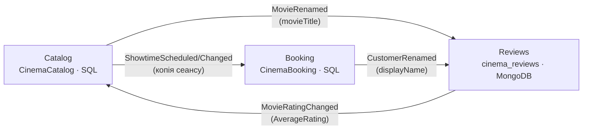

# Предметна область і межі контекстів (Bounded Contexts)

## Домен: «Кінотеатр»

Онлайн-система мережевого кінотеатру. **Глядачі** переглядають афішу й розклад, бронюють і оплачують квитки на конкретні місця, а після перегляду залишають відгуки та обговорюють фільми. **Адміністратори** кінотеатру ведуть каталог фільмів, залів і сеансів, а **касири** перевіряють бронювання та пропускають глядачів у зал.

Систему поділено на 3 незалежні контексти. Кожен контекст має **власну базу даних**, між базами немає спільних таблиць і жодного `FOREIGN KEY`. Сутність іншого контексту відома лише за її **Id** (звичайний стовпець або поле).

## Контексти та їхні сутності

| № | Контекст (мікросервіс) | БД / технологія | Власні сутності | Чужі Id, які зберігаються |
|---|---|---|---|---|
| 1 | **Booking**: бронювання й оплата квитків | `CinemaBooking`, SQL Server, ADO.NET + Dapper (Лаб. 02) | Customer, Booking, BookingDetail, Ticket, Payment; Showtime (лише **локальна копія** для читання) | `Showtimes.Id`, `Showtimes.MovieId` → Catalog |
| 2 | **Catalog**: фільми, жанри, зали, розклад сеансів | `CinemaCatalog`, SQL Server, EF Core Code First (Лаб. 03) | Movie, MovieDetail, Genre, MovieGenre, Hall, Showtime | — (копія рейтингу з Reviews: `Movies.AverageRating`, `ReviewsCount`) |
| 3 | **Reviews**: відгуки, коментарі, обговорення, рейтинги | `cinema_reviews`, MongoDB (Лаб. 04) | review (з вбудованими comment), discussion, discussionMessage, movieRating | `movieId` → Catalog, `author.customerId` → Booking |

### Чому саме такий розподіл

* **Booking → SQL + процедури.** Бронювання це транзакційний процес зі строгими переходами статусів (`Created → AwaitingPayment → Paid → CheckedIn`, скасування лише до оплати), конкуренцією за місця й грошима. Тут потрібні транзакції, блокування рядків і перевірка цілісності на рівні БД.
* **Catalog → SQL + EF Core.** Багато пов'язаних сутностей з усіма типами зв'язків (1:1 Movie–MovieDetail, 1:N Movie–Showtime і Hall–Showtime, M:N Movie–Genre), довідникові seed-дані, схема часто змінюється, тому підходять міграції.
* **Reviews → MongoDB.** Відгуки мають різну структуру (короткий з однією оцінкою, повний з фото, відгук критика з `criticInfo`), вкладені коментарі та довгі обговорення. Це документні агрегати зі змінною схемою.

### Хто власник яких даних

| Дані | Власник | Хто має лише копію / Id |
|---|---|---|
| Фільм (назва, тривалість, ціна), зал, сеанс | Catalog | Booking (копія сеансу, знімок у квитку), Reviews (`movieTitle`) |
| Клієнт (ім'я, email) | Booking | Reviews (`author.displayName`) |
| Відгуки й рейтинг фільму | Reviews | Catalog (`Movies.AverageRating`, `ReviewsCount`) |

Кожну сутність **редагує лише її власник**. Копії оновлюються подіями від власника (механізм буде в Лаб. 08) або є знімками, які свідомо не оновлюються. Подвійного запису (dual write) немає.

## Агрегати

| Контекст | Агрегат (корінь → частини) | Життєвий цикл |
|---|---|---|
| Booking | **Booking** → BookingDetail (1:1), Ticket (M:N із Showtime), Payment (1:N) | Квитки й деталі не існують без бронювання (`ON DELETE CASCADE`). Змінюються лише через процедури бронювання. |
| Booking | **Customer** | Самостійний. Не видаляється фізично, якщо є історія бронювань (`NO ACTION`, `IsDeleted`). |
| Catalog | **Movie** → MovieDetail (1:1), MovieGenre (M:N) | Деталі та зв'язки з жанрами видаляються разом із фільмом. |
| Catalog | **Hall**, **Showtime**, **Genre** | Сеанс посилається на фільм і зал. Фільм або зал із сеансами видалити не можна. |
| Reviews | **review** → author, comments[] (вбудовані) | Коментарі до відгуку завжди читаються разом з ним, їх мало (≤ 50). |
| Reviews | **discussion** → recentMessages[] (вбудовані) + discussionMessages (окрема колекція) | Повідомлень може бути тисячі, тому вони лежать окремо (гібридний підхід). |
| Reviews | **movieRating** | Read-модель, перераховується з reviews. |

## Взаємодія між контекстами

Стрілки це **асинхронні події** (Лаб. 08), а не FK і не JOIN між базами.
