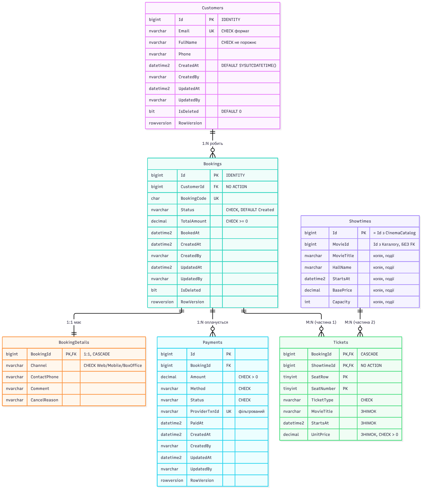
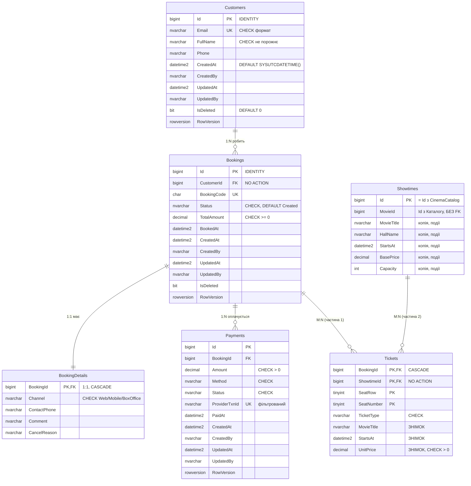
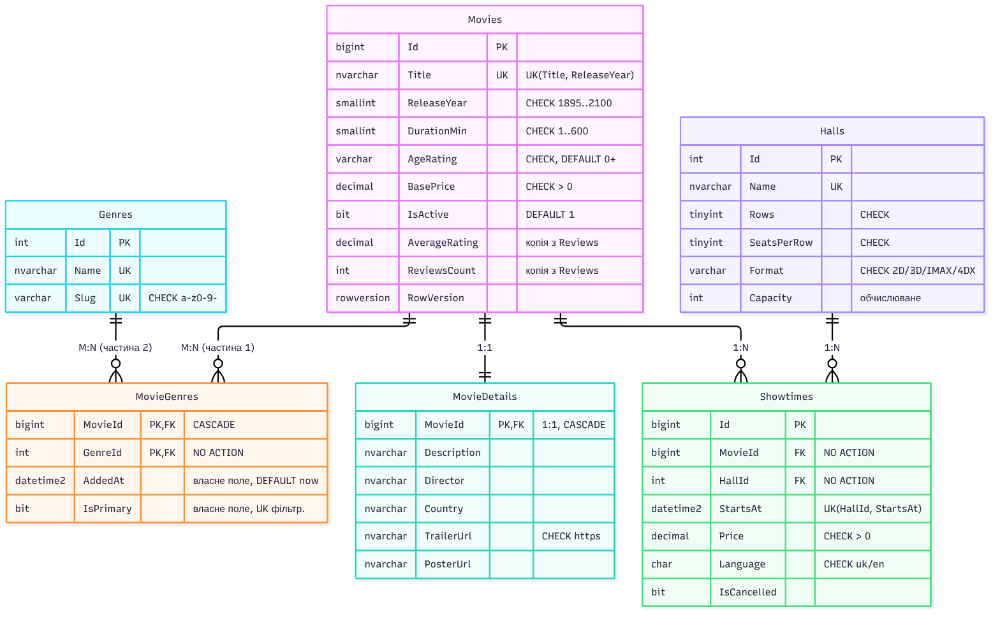
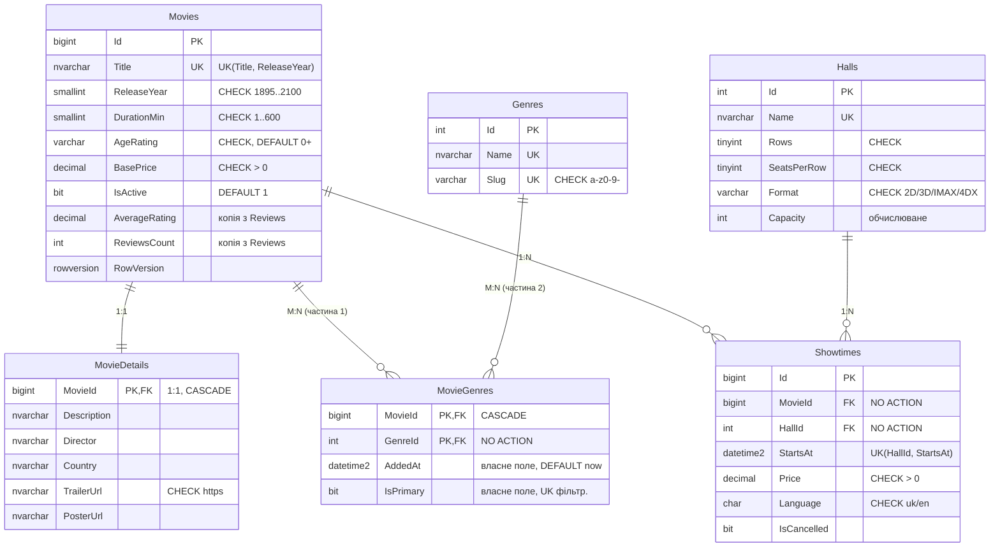
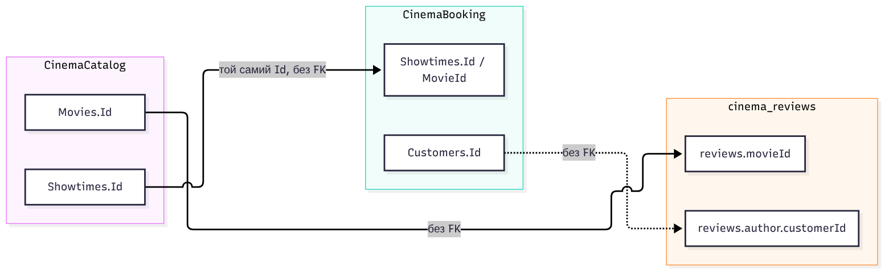
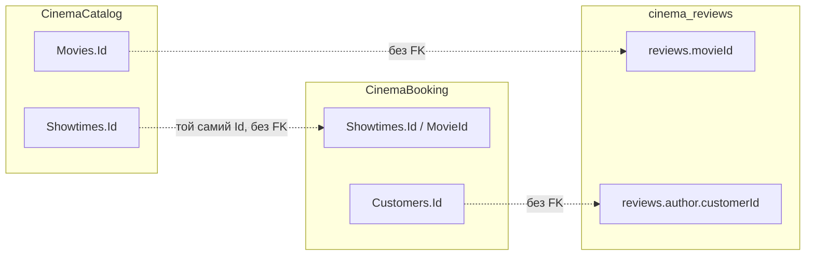

# ERD-діаграми

Діаграми подано двічі: як зображення (`erd-p1.png`, `erd-p2.png`, `cross-db-links.png`) і як код Mermaid, який GitHub теж малює. Той самий опис у форматі DBML для [dbdiagram.io](https://dbdiagram.io) лежить у `docs/erd-p1.dbml` і `docs/erd-p2.dbml`: відкрийте dbdiagram.io → Import → вставте вміст файлу.

Позначення: `PK` первинний ключ, `FK` зовнішній ключ, `UK` унікальний. `||--||` це 1:1, `||--o{` це 1:N, M:N реалізовано через проміжну таблицю.

## Проєкт №1 · CinemaBooking (SQL Server, ADO.NET + Dapper)

| Зв'язок | Таблиці | Де FK |
|---|---|---|
| 1:1 | Bookings ↔ BookingDetails | `BookingDetails.BookingId` є і PK, і FK |
| 1:N | Customers → Bookings, Bookings → Payments | `Bookings.CustomerId`, `Payments.BookingId` (на боці «багатьох») |
| M:N | Bookings ↔ Showtimes | проміжна `Tickets` (два FK + власні поля: місце, тип, ціна) |

## Проєкт №2 · CinemaCatalog (SQL Server, EF Core)

| Зв'язок | Таблиці | Де FK |
|---|---|---|
| 1:1 | Movies ↔ MovieDetails | `MovieDetails.MovieId` є і PK, і FK |
| 1:N | Movies → Showtimes, Halls → Showtimes | `Showtimes.MovieId`, `Showtimes.HallId` |
| M:N | Movies ↔ Genres | проміжна `MovieGenres` з власними полями `AddedAt`, `IsPrimary` |

## Логічні посилання між базами (без FOREIGN KEY)

